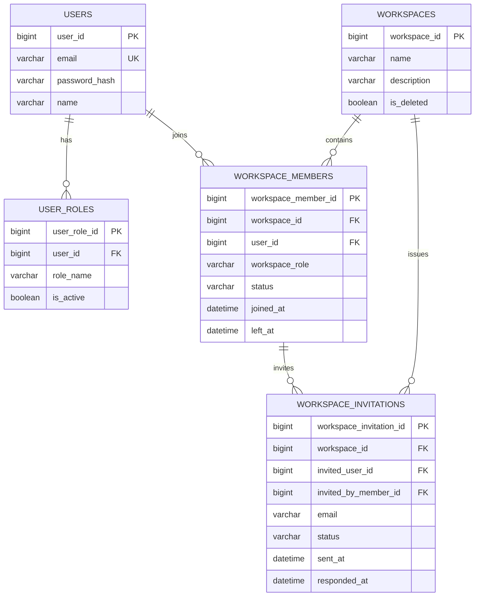
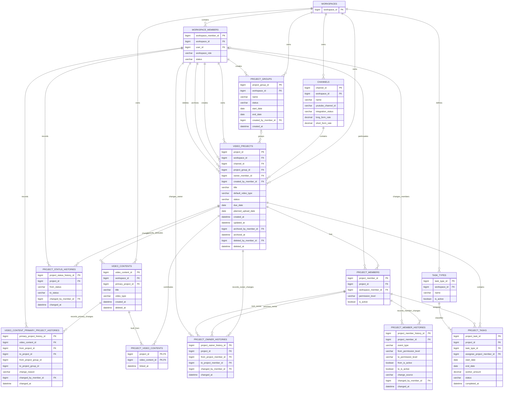
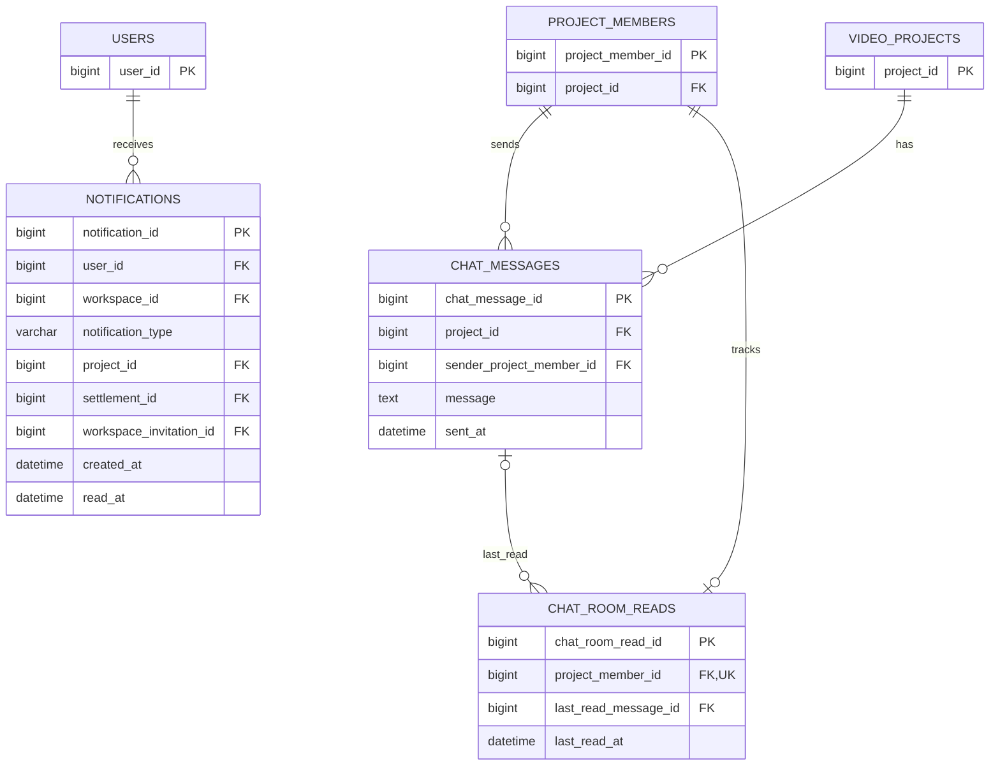
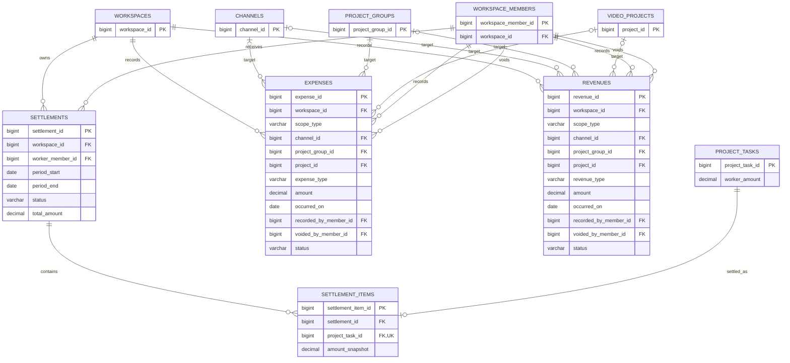
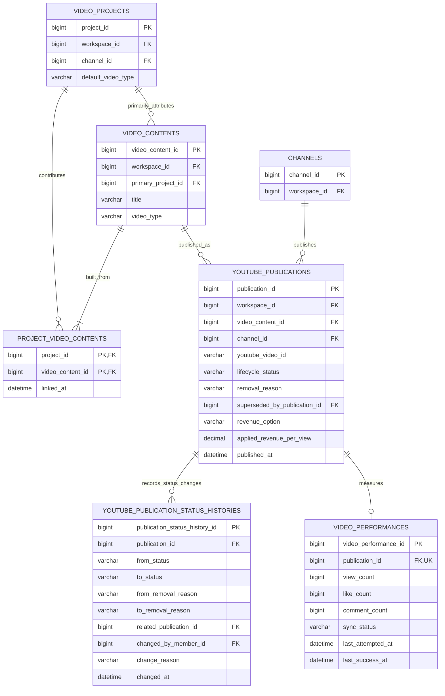

# 데이터베이스 설계 및 ERD

> YMS의 테이블 구조, 관계, 제약조건과 데이터 정책을 정의합니다.  
> 본 문서는 현재 요구사항과 사용자 시나리오를 기준으로 기존 블로그 설계를 전면 재작성한 기준 문서입니다.

> **용어 기준:** 이 문서의 `Workspace` 엔터티는 사용자 화면에서 `제작팀`으로 표시합니다. 테이블명, 컬럼명과 ERD 엔터티명은 기존 `workspaces` / `workspace_*`를 유지합니다.

## 1. 설계 원칙

YMS의 데이터 구조는 `User → Project` 중심의 초기 구조에서 **Workspace를 업무 데이터의 최상위 경계로 사용하는 구조**로 확장합니다.

핵심 관계는 다음과 같습니다.

```text
User
 └─ Workspace Member
      ├─ Channel
      ├─ ProjectGroup
      │    └─ Project (선택적 연결)
      └─ Project
           ├─ Project Member
           ├─ Task
           ├─ Chat
           └─ YouTube Performance

Workspace
 ├─ Expense
 ├─ Revenue
 └─ Settlement
```

주요 원칙:

- 사용자 전문 역할과 Workspace 권한을 분리합니다.
- ProjectGroup은 Workspace 소속이며 Channel을 직접 소유하지 않습니다.
- Project는 반드시 하나의 Channel에 속하고 ProjectGroup에는 선택적으로 속합니다.
- ProjectGroup과 Project의 관계는 **1:N**이며 하나의 Project가 여러 ProjectGroup에 동시에 속하지 않습니다.
- Project Task의 담당자는 `users`가 아니라 `project_members`를 참조합니다.
- Project 소유자는 `video_projects.owner_member_id`로 명시합니다.
- Expense와 Revenue는 Workspace / Channel / ProjectGroup / Project 중 **한 곳에만 직접 귀속**합니다.
- 실제 Revenue와 조회수 기반 예상 수익을 분리합니다.
- 예상 YouTube 플랫폼 수익은 저장하지 않고 `view_count × applied_revenue_per_view`로 계산합니다.
- 금액과 조회수 1회당 수익 단가는 부동소수점이 아닌 `DECIMAL`을 사용합니다.
- 핵심 관계에는 물리 FK를 적용하고, 동일 Workspace 여부처럼 단일 FK만으로 표현하기 어려운 규칙은 애플리케이션 트랜잭션에서도 재검증합니다.

---

## 2. 마스터 / 트랜잭션 및 감사 정책

### 2.1. 분류 원칙

YMS에서는 데이터 성격을 다음과 같이 구분합니다.

- **Master**: 비교적 장기간 유지되며 다른 업무 데이터의 기준이 되는 사용자, 조직, 채널, 작업 종류 등의 데이터
- **Transaction**: 초대, 프로젝트 그룹, 프로젝트, 작업, 메시지, 비용, 수익, 정산 등 실제 업무 과정에서 계속 발생하는 데이터

### 2.2. 감사 컬럼 원칙

Master 테이블에는 다음 감사 컬럼을 기본 적용합니다.

| 컬럼 | 타입 | 설명 |
| --- | --- | --- |
| created_by | BIGINT | 최초 등록 사용자 ID. 시스템 또는 자기 자신이 등록하는 경우 NULL 허용 |
| created_at | DATETIME | 최초 등록 시각 |
| updated_by | BIGINT | 마지막 수정 사용자 ID |
| updated_at | DATETIME | 마지막 수정 시각 |

기존 설계처럼 모든 테이블에 `is_deleted`, `deleted_by`, `deleted_at`을 일괄 추가하지 않습니다.

삭제 또는 비활성화가 실제 업무 의미를 가지는 테이블에서만 다음 중 적절한 방식을 선택합니다.

- `is_active`
- 상태값
- `archived_at`
- `deleted_at` / `deleted_by`

Transaction 테이블에는 일반 감사 컬럼을 기본 적용하지 않습니다.

다만 실제 운용에서 반드시 필요한 행위자와 시각은 일반 감사 컬럼이 아니라 **업무 컬럼**으로 유지합니다.

예:

- Workspace 초대: `invited_by_member_id`, `sent_at`, `responded_at`
- 채팅: `sender_project_member_id`, `sent_at`
- 정산: `created_by_member_id`, `confirmed_by_member_id`, `paid_by_member_id`
- 프로젝트 삭제: `deleted_by_member_id`, `deleted_at`
- Expense / Revenue: `recorded_by_member_id`, `recorded_at`, 수정자 / 수정 시각

### 2.3. 테이블별 감사 컬럼 재검토 결과

| 테이블 | 분류 | 일반 감사 컬럼 | 운용 관점 판단 |
| --- | --- | --- | --- |
| users | Master | 적용 | 계정 정보 변경 추적 필요. 단, 회원 탈퇴 정책은 아직 확정하지 않았으므로 탈퇴 상태 컬럼은 추가하지 않음 |
| user_roles | Master | 적용 | 전문 역할 변경이 담당자 검색과 업무 배정에 영향 |
| workspaces | Master | 적용 | 조직 정보 및 관리 주체 변경 추적 필요 |
| workspace_members | Master | 적용 | OWNER / ADMIN / MEMBER 권한 변경은 추적 가치가 큼 |
| channels | Master | 적용 | 채널 ID 및 연동 상태 변경이 Project와 YouTube 연동에 영향 |
| task_types | Master | 적용 | 작업 종류 추가 / 비활성화 이력 확인 필요 |
| workspace_invitations | Transaction | 미적용 | 초대자, 발송 / 응답 시각이 자체 업무 데이터이므로 별도 감사 컬럼 불필요 |
| project_groups | Transaction | 미적용 | 범용 Audit은 두지 않되 프로젝트 그룹 생성자 / 생성 시각은 업무 발생 정보로 보존 |
| video_projects | Transaction | 미적용 | 범용 Audit은 두지 않되 최초 생성자 / 생성 시각과 보관 / 삭제 라이프사이클 정보는 보존 |
| project_members | Transaction | 미적용 | 현재 참여 상태를 관리하고 변경 사건은 전용 이력 테이블에 보존 |
| project_member_histories | Transaction | 미적용 | 참여·재참여·권한 변경·종료 사건과 처리자를 보존 |
| project_owner_histories | Transaction | 미적용 | Project 소유권 이전 전후와 처리자를 보존 |
| project_status_histories | Transaction | 미적용 | 변경 전후 상태, 변경자와 변경 시각이 자체 이력 |
| project_tasks | Transaction | 미적용 | 일정, 상태, 완료 시각이 핵심. 정산 확정 후 금액은 Settlement Item에서 스냅샷 보존 |
| chat_messages | Transaction | 미적용 | 발신자와 전송 시각 자체가 감사 정보 역할 |
| chat_room_reads | Transaction | 미적용 | 현재 읽음 위치를 보관하는 상태 데이터 |
| notifications | Transaction | 미적용 | 생성 시각 / 읽음 시각 자체가 업무 데이터 |
| expenses | Transaction | **최소 추적 예외 적용** | 수동 입력 금액이 ROI에 직접 영향하므로 등록자 / 수정자와 시각 유지 |
| revenues | Transaction | **최소 추적 예외 적용** | 실제 수익 수정은 재무 성과에 직접 영향하므로 등록자 / 수정자와 시각 유지 |
| settlements | Transaction | 미적용 | 생성 / 확정 / 지급 단계별 행위자와 시각을 명시적으로 보관 |
| settlement_items | Transaction | 미적용 | CONFIRMED 시점의 불변 스냅샷 성격 |
| video_contents | Transaction | 미적용 | 생성 시각과 논리 삭제 라이프사이클 정보는 별도 보존 |
| project_video_contents | Mapping | 미적용 | Project와 영상 결과물의 연결 사실만 관리 |
| video_content_primary_project_histories | Transaction | 미적용 | 대표 Project 및 성과 귀속 변경 사건을 보존 |
| youtube_publications | Transaction | 미적용 | 게시물과 대체 관계, 생성 시각을 업무 데이터로 보존 |
| youtube_publication_status_histories | Transaction | 미적용 | 게시물 상태·종료 사유·대체 관계 변경 사건을 보존 |
| video_performances | Transaction | 미적용 | 외부 API 동기화 상태와 마지막 성공 / 시도 시각이 핵심 |

---

## 3. 전체 테이블 목록

| 도메인 | 테이블 | 설명 |
| --- | --- | --- |
| 사용자 | users | 사용자 계정 및 기본 프로필 |
| 사용자 | user_roles | 전역 고정 전문 역할의 사용자별 다중 매핑 |
| Workspace | workspaces | 조직 / 팀 단위 최상위 업무 영역 |
| Workspace | workspace_members | Workspace 참여자 및 권한 |
| Workspace | workspace_invitations | 이메일 기반 Workspace 초대 |
| Channel | channels | Workspace가 관리하는 YouTube 채널 |
| ProjectGroup | project_groups | 여러 Project를 묶는 선택적 상위 업무 단위 |
| Project | video_projects | 영상 제작 프로젝트 |
| Project | project_members | Project 참여자 및 EDIT / VIEW 권한 |
| Project | project_member_histories | Project 참여와 권한 변경 감사 이력 |
| Project | project_owner_histories | Project 소유권 이전 감사 이력 |
| Project | project_status_histories | Project 상태 변경 이력 |
| VideoContent | video_contents | 완성된 논리적 영상 결과물 |
| VideoContent | project_video_contents | Project와 영상 결과물의 다대다 연결 |
| VideoContent | video_content_primary_project_histories | 대표 Project 및 ProjectGroup 귀속 변경 이력 |
| Task | task_types | Workspace별 확장 가능한 작업 종류 |
| Task | project_tasks | 실제 세부 작업과 담당자 / 일정 / 지급액 |
| Chat | chat_messages | Project 실시간 채팅 메시지 |
| Chat | chat_room_reads | Project별 사용자 마지막 읽음 위치 |
| Notification | notifications | 작업, 채팅, 초대, 정산 알림 |
| Finance | expenses | 실제 제작 비용 |
| Finance | revenues | 실제 발생 수익 |
| Settlement | settlements | 작업자 단위 정산 Header |
| Settlement | settlement_items | 정산에 포함된 Task 금액 스냅샷 |
| YouTube | youtube_publications | 영상 결과물의 실제 YouTube 게시 이력 |
| YouTube | youtube_publication_status_histories | 게시물 생명주기 변경 이력 |
| YouTube | video_performances | YouTube 게시물별 최신 성과 데이터 |

총 25개 테이블을 초기 설계 범위로 정의합니다.

---

# 4. 사용자 도메인

## 4.1. users

사용자 계정과 개인 기본 정보를 관리합니다.

| 컬럼 | 타입 | 제약 | 설명 |
| --- | --- | --- | --- |
| user_id | BIGINT | PK | 사용자 ID |
| email | VARCHAR(255) | NOT NULL, UNIQUE | 로그인 이메일 |
| password_hash | VARCHAR(255) | NOT NULL | 단방향 비밀번호 해시 |
| name | VARCHAR(50) | NOT NULL | 이름 / 닉네임 |
| created_by | BIGINT | NULL | 등록 사용자 ID |
| created_at | DATETIME | NOT NULL | 등록 시각 |
| updated_by | BIGINT | NULL | 마지막 수정 사용자 ID |
| updated_at | DATETIME | NULL | 마지막 수정 시각 |

> 회원 탈퇴 및 탈퇴 이메일 재사용 정책은 현재 요구사항에서 확정하지 않았으므로 `WITHDRAWN`, `is_deleted` 등의 계정 상태는 이번 설계에 포함하지 않습니다.

## 4.2. user_roles

한 사용자가 여러 전문 역할을 동시에 가질 수 있도록 합니다.

| 컬럼 | 타입 | 제약 | 설명 |
| --- | --- | --- | --- |
| user_role_id | BIGINT | PK | 역할 매핑 ID |
| user_id | BIGINT | FK → users | 사용자 |
| role_name | VARCHAR(30) | NOT NULL | CREATOR / PLANNER / WRITER / VIDEOGRAPHER / EDITOR / THUMBNAILER |
| is_active | BOOLEAN | NOT NULL | 현재 사용 여부 |
| created_by | BIGINT | NULL | 등록 사용자 |
| created_at | DATETIME | NOT NULL | 등록 시각 |
| updated_by | BIGINT | NULL | 수정 사용자 |
| updated_at | DATETIME | NULL | 수정 시각 |

제약:

- `UNIQUE(user_id, role_name)`
- 역할을 다시 선택하는 경우 새 행을 만들기보다 `is_active`를 재활성화합니다.
- 역할명은 애플리케이션 Enum으로 관리합니다.
- 모든 전문 역할은 담당자 검색과 필터에 동일하게 사용하며 특정 역할에 기능이나 재무 권한을 부여하지 않습니다.
- 세부 업무 종류는 `task_types`에서 Workspace별로 확장하며 전문 역할을 사용자 정의하지 않습니다.

---

# 5. Workspace 및 Channel 도메인

## 5.1. workspaces

YMS의 업무 데이터가 속하는 최상위 조직 단위입니다.

| 컬럼 | 타입 | 제약 | 설명 |
| --- | --- | --- | --- |
| workspace_id | BIGINT | PK | Workspace ID |
| name | VARCHAR(100) | NOT NULL | Workspace명 |
| description | VARCHAR(500) | NULL | 설명 |
| is_deleted | BOOLEAN | NOT NULL | 논리 삭제 여부 |
| created_by | BIGINT | NULL | 등록 사용자 |
| created_at | DATETIME | NOT NULL | 등록 시각 |
| updated_by | BIGINT | NULL | 수정 사용자 |
| updated_at | DATETIME | NULL | 수정 시각 |
| deleted_by | BIGINT | NULL | 삭제 사용자 |
| deleted_at | DATETIME | NULL | 삭제 시각 |

Workspace 삭제 시 하위 업무 이력까지 즉시 물리 삭제하지 않습니다.

## 5.2. workspace_members

사용자가 Workspace 안에서 가지는 조직 권한을 관리합니다.

| 컬럼 | 타입 | 제약 | 설명 |
| --- | --- | --- | --- |
| workspace_member_id | BIGINT | PK | Workspace 멤버 ID |
| workspace_id | BIGINT | FK → workspaces | Workspace |
| user_id | BIGINT | FK → users | 사용자 |
| workspace_role | VARCHAR(20) | NOT NULL | OWNER / ADMIN / MEMBER |
| status | VARCHAR(20) | NOT NULL | ACTIVE / LEFT / REMOVED |
| joined_at | DATETIME | NOT NULL | 참여 시각 |
| left_at | DATETIME | NULL | 탈퇴 / 제외 시각 |
| created_by | BIGINT | NULL | 등록 사용자 |
| created_at | DATETIME | NOT NULL | 등록 시각 |
| updated_by | BIGINT | NULL | 수정 사용자 |
| updated_at | DATETIME | NULL | 수정 시각 |

제약:

- `UNIQUE(workspace_id, user_id)`
- Workspace에는 항상 최소 한 명의 ACTIVE OWNER가 존재해야 합니다.
- 복수 OWNER를 허용하며 OWNER만 다른 ACTIVE 멤버에게 OWNER 권한을 부여할 수 있습니다.
- OWNER는 다른 ACTIVE OWNER가 있을 때만 자신의 권한을 ADMIN 또는 MEMBER로 변경할 수 있습니다.
- ADMIN은 일반 MEMBER만 제외할 수 있으며 OWNER·ADMIN 권한 변경과 제외는 허용하지 않습니다.
- `deleted_at IS NULL`인 Project를 소유한 멤버는 LEFT 또는 REMOVED로 변경할 수 없습니다. 보관 여부와 Project 상태는 이 검사에서 제외 조건이 아닙니다.
- 멤버를 LEFT 또는 REMOVED로 변경할 때 해당 멤버의 ACTIVE `project_members`를 같은 트랜잭션에서 비활성화하고 `left_at`을 기록합니다.
- 재참여 시 중복 행을 만들지 않고 기존 멤버 상태를 ACTIVE, Workspace 권한을 MEMBER로 변경하지만 이전 Project 소유권과 `project_members` 상태를 자동 복구하지 않습니다.
- 현재 사용자의 제작팀 나가기는 해당 Workspace Member를 LEFT로 변경하며, 관리자가 다른 멤버를 제외하는 REMOVED와 구분합니다.
- 마지막 ACTIVE OWNER는 LEFT로 변경할 수 없습니다. 비삭제 Project를 소유한 멤버도 LEFT 또는 REMOVED로 변경할 수 없습니다.
- 제외·탈퇴 영향 화면의 소유 Project, 활성 Project 참여와 미완료 Task 수는 현재 데이터를 집계한 파생 값이며 별도 컬럼으로 저장하지 않습니다.
- #18 이전 Mock에서는 기존 Project Member 메타의 `incompleteTaskCount`를 샘플 영향 수로 사용합니다. 실제 Task 저장소 구현 후에는 `project_tasks.assignee_project_member_id`와 미완료 상태를 기준으로 집계하며 별도 중복 집계 컬럼을 추가하지 않습니다.
- Workspace Member 상태 변경과 대상의 ACTIVE Project Member 비활성화 및 Project Member 이력 추가는 하나의 트랜잭션에서 처리합니다.

## 5.3. workspace_invitations

Workspace 초대 흐름을 기록합니다.

| 컬럼 | 타입 | 제약 | 설명 |
| --- | --- | --- | --- |
| workspace_invitation_id | BIGINT | PK | 초대 ID |
| workspace_id | BIGINT | FK → workspaces | 초대 대상 Workspace |
| email | VARCHAR(255) | NOT NULL | 초대 이메일 |
| invited_user_id | BIGINT | FK → users, NULL | 이미 가입된 사용자 또는 가입 후 연결된 사용자 |
| invited_by_member_id | BIGINT | FK → workspace_members | 초대한 OWNER / ADMIN |
| status | VARCHAR(20) | NOT NULL | PENDING / ACCEPTED / REJECTED / CANCELLED |
| sent_at | DATETIME | NOT NULL | 발송 시각 |
| expires_at | DATETIME | NULL | 초대 만료 시각 |
| responded_at | DATETIME | NULL | 수락 / 거절 시각 |

동일 Workspace / 정규화 이메일에 유효한 PENDING 초대가 중복 생성되지 않도록 애플리케이션에서 검증합니다. 만료 여부는 `status=PENDING`과 `expires_at`을 함께 사용해 판정하며 별도 EXPIRED 상태를 저장하지 않습니다.

ACTIVE 멤버에게는 초대를 생성할 수 없지만 LEFT 또는 REMOVED 멤버는 다시 초대할 수 있습니다. 초대 수락 시 기존 `workspace_members` 행을 ACTIVE·MEMBER 상태로 복구합니다.

## 5.4. channels

Workspace에서 관리하는 YouTube 채널입니다.

| 컬럼 | 타입 | 제약 | 설명 |
| --- | --- | --- | --- |
| channel_id | BIGINT | PK | Channel ID |
| workspace_id | BIGINT | FK → workspaces | 소속 Workspace |
| name | VARCHAR(150) | NOT NULL | 채널명 |
| youtube_channel_id | VARCHAR(64) | NULL | YouTube Channel ID |
| youtube_channel_url | VARCHAR(255) | NULL | 채널 URL |
| description | VARCHAR(500) | NULL | 설명 |
| integration_status | VARCHAR(20) | NOT NULL | MANUAL / CONNECTED / DISCONNECTED / ERROR |
| long_form_rate | DECIMAL(12,6) | NOT NULL, DEFAULT 0 | 롱폼 조회수 1회당 기본 단가 |
| short_form_rate | DECIMAL(12,6) | NOT NULL, DEFAULT 0 | 쇼츠 조회수 1회당 기본 단가 |
| is_active | BOOLEAN | NOT NULL | 신규 Project에서 사용 가능 여부 |
| created_by | BIGINT | NULL | 등록 사용자 |
| created_at | DATETIME | NOT NULL | 등록 시각 |
| updated_by | BIGINT | NULL | 수정 사용자 |
| updated_at | DATETIME | NULL | 수정 시각 |

제약:

- `UNIQUE(workspace_id, youtube_channel_id)` 적용을 기본으로 합니다.
- 채널명만 필수이며 `youtube_channel_id`, `youtube_channel_url`과 `description`은 입력하지 않을 수 있습니다.
- ID나 URL을 참고 정보로 입력했더라도 실제 연동 절차가 완료되지 않았으면 `integration_status=MANUAL`을 유지합니다.
- Project와 Channel을 직접 참조하는 비용·수익 등 업무 데이터에서 사용하지 않는 Channel만 물리 삭제할 수 있습니다.
- 업무 데이터가 연결된 Channel은 삭제하지 않고 비활성화하며 기존 이력을 유지합니다.
- 두 기본 단가는 0 이상, 소수점 여섯째 자리까지 저장하고 미입력 값은 0으로 정규화합니다.
- Channel 기본 단가 변경은 기존 YouTubePublication의 `applied_revenue_per_view`를 자동 변경하지 않습니다.

---

# 6. ProjectGroup 및 Project 도메인

## 6.1. project_groups

여러 Project의 실제 비용과 외부 수익을 함께 분석하기 위한 선택적 상위 단위입니다.

| 컬럼 | 타입 | 제약 | 설명 |
| --- | --- | --- | --- |
| project_group_id | BIGINT | PK | ProjectGroup ID |
| workspace_id | BIGINT | FK → workspaces | 소속 Workspace |
| name | VARCHAR(150) | NOT NULL | 프로젝트 그룹명 |
| description | TEXT | NULL | 설명 |
| start_date | DATE | NULL | 시작일 |
| end_date | DATE | NULL | 종료일 |
| status | VARCHAR(20) | NOT NULL | PLANNING / ACTIVE / COMPLETED / CANCELLED |
| created_by_member_id | BIGINT | FK → workspace_members | 프로젝트 그룹 생성자 |
| created_at | DATETIME | NOT NULL | 프로젝트 그룹 생성 시각 |

`created_by_member_id`와 `created_at`은 범용 감사 컬럼이 아니라 프로젝트 그룹이 누가 언제 생성했는지를 보존하는 업무 발생 정보입니다.

정책:

- 생성 상태는 PLANNING입니다.
- 같은 Workspace에서는 이름의 앞뒤 공백을 제거하고 영문 대소문자를 구분하지 않은 값으로 중복을 검증합니다.
- ProjectGroup은 Channel FK를 가지지 않으며 서로 다른 Channel의 Project를 포함할 수 있습니다.
- COMPLETED / CANCELLED 상태에는 새 Project를 연결하지 않지만 Expense와 Revenue는 추가하거나 정정할 수 있습니다.
- 연결된 Project, 직접 Expense 또는 직접 Revenue가 하나라도 존재하면 삭제하지 않고 COMPLETED / CANCELLED 상태로 이력을 보존합니다.
- 연결 데이터가 전혀 없는 ProjectGroup만 삭제할 수 있으며 서비스 계층에서 삭제 직전에 다시 검증합니다.

## 6.2. video_projects

영상 제작과 협업의 핵심 Transaction입니다.

| 컬럼 | 타입 | 제약 | 설명 |
| --- | --- | --- | --- |
| project_id | BIGINT | PK | Project ID |
| workspace_id | BIGINT | FK → workspaces | 소속 Workspace |
| channel_id | BIGINT | FK → channels | 담당 Channel |
| project_group_id | BIGINT | FK → project_groups, NULL | 선택적 ProjectGroup |
| owner_member_id | BIGINT | FK → workspace_members | Project 소유자 |
| title | VARCHAR(150) | NOT NULL | 프로젝트 제목 |
| content | TEXT | NULL | 기획 내용 |
| default_video_type | VARCHAR(20) | NOT NULL | 새 VideoContent의 초기 LONG / SHORTS 값 |
| status | VARCHAR(20) | NOT NULL | PLANNING / EDITING / REVIEW / UPLOADED / CANCELLED |
| due_date | DATE | NULL | 제작 마감일 |
| planned_upload_date | DATE | NULL | 업로드 예정일 |
| created_by_member_id | BIGINT | FK → workspace_members | Project 최초 생성자 |
| created_at | DATETIME | NOT NULL | Project 생성 시각 |
| updated_at | DATETIME | NOT NULL | Project 최종 수정 시각과 목록 기본 정렬 기준 |
| archived_by_member_id | BIGINT | FK → workspace_members, NULL | 보관 처리 사용자 |
| archived_at | DATETIME | NULL | 보관 시각 |
| deleted_by_member_id | BIGINT | FK → workspace_members, NULL | 삭제 처리 사용자 |
| deleted_at | DATETIME | NULL | 논리 삭제 시각 |

정책:

- Project는 반드시 하나의 Channel에 속합니다.
- ProjectGroup은 선택값이며 한 Project는 최대 하나의 ProjectGroup에만 속합니다.
- ProjectGroup 연결 생성, 변경과 해제는 Workspace OWNER와 ADMIN만 수행합니다.
- ProjectGroup을 변경하면 Project 직접 Expense, Revenue와 Task 지급 금액은 Project를 따라 새 그룹의 집계에 반영합니다. 해당 Project가 대표인 VideoContent의 콘텐츠 성과도 새 그룹으로 이동하므로 동기화된 성과 또는 계산 가능한 예상 플랫폼 수익이 있으면 변경 전에 영향을 확인합니다.
- `workspace_id`는 Channel을 통해 유추할 수 있지만 tenant 범위 조회와 권한 검증을 위해 명시적으로 유지합니다.
- 논리 삭제되지 않은 Project의 `owner_member_id`는 동일 Workspace의 ACTIVE 멤버여야 합니다. 논리 삭제 Project는 당시 소유자를 이력으로 유지하므로 LEFT 또는 REMOVED 멤버를 참조할 수 있습니다.
- Owner는 `project_members`에도 EDIT 권한 참여자로 등록하는 것을 애플리케이션 규칙으로 둡니다.
- 현재 Owner에 해당하는 Project Member는 비활성화하거나 VIEW로 낮출 수 없습니다.
- Owner 변경 대상은 같은 Project의 ACTIVE EDIT Project Member여야 하며, 참여자 생성·재활성화 또는 VIEW의 자동 승격과 소유권 이전을 한 동작으로 처리하지 않습니다.
- 이전 Owner가 ACTIVE Workspace Member이면 일반 EDIT Project Member로 남습니다. 이후 제작팀에서 제외·탈퇴하면 다른 Project 참여와 함께 비활성화합니다.
- `created_by_member_id`와 `created_at`은 Owner 변경과 무관하게 최초 생성 정보를 유지합니다.
- 삭제는 하위 Task, Chat, Expense, Revenue 이력을 보존하기 위해 논리 삭제를 사용합니다.
- 보관과 삭제는 Project 진행 상태와 별도입니다.
- 생성 시 status는 PLANNING 또는 EDITING만 허용하며 별도 입력이 없으면 PLANNING을 사용합니다.
- `channel_id`와 `default_video_type`은 새 VideoContent 및 YouTubePublication 입력의 기본값이며 실제 결과물 유형이나 게시 Channel을 확정하지 않습니다.
- UPLOADED / CANCELLED만 보관할 수 있고 활성 상태로 변경하면 `archived_by_member_id`와 `archived_at`을 null로 되돌립니다.
- 삭제된 Project의 실제 Expense, Revenue와 확정 Settlement는 집계에서 유지하고 콘텐츠 성과와 예상 수익 집계에서는 제외합니다.

## 6.3. video_contents

사용자에게 한 편의 콘텐츠로 인식되는 완성 영상 결과물입니다. 제작 과정인 Project와 실제 플랫폼 업로드인 YouTubePublication 사이의 논리적 단위입니다.

| 컬럼 | 타입 | 제약 | 설명 |
| --- | --- | --- | --- |
| video_content_id | BIGINT | PK | 영상 결과물 ID |
| workspace_id | BIGINT | FK → workspaces | 소속 Workspace |
| primary_project_id | BIGINT | FK → video_projects | 콘텐츠 성과 집계 기준 대표 Project |
| title | VARCHAR(150) | NOT NULL | 영상 결과물 제목 |
| video_type | VARCHAR(20) | NOT NULL | LONG / SHORTS |
| created_at | DATETIME | NOT NULL | 생성 시각 |
| deleted_at | DATETIME | NULL | 논리 삭제 시각 |

정책:

- VideoContent는 게시 전에도 생성할 수 있으며 하나 이상의 Project와 연결되어야 합니다.
- `primary_project_id`는 `project_video_contents`에 연결된 Project 중 하나여야 하며 같은 Workspace에 속해야 합니다.
- 연결된 모든 Project 상세에서 결과물과 공개 성과를 조회할 수 있지만 Project 및 ProjectGroup 집계에는 대표 Project만 사용합니다.
- 대표를 같은 ProjectGroup 안에서 변경하거나 양쪽 모두 그룹이 없으면 현재·새 Project를 모두 관리할 수 있는 프로젝트 소유자, EDIT 참여자와 Workspace 관리자가 변경할 수 있습니다. ProjectGroup 경계가 달라지는 변경은 OWNER와 ADMIN만 수행합니다.
- Project 삭제 시 연결과 결과물 이력은 보존하되 삭제 Project를 집계 대상으로 사용하지 않습니다. 다른 활성 연결 Project가 있으면 사용자가 새 대표를 지정한 뒤 삭제하고, 없으면 기존 `primary_project_id`를 역사적 대표로 유지한 채 활성 집계에서 제외합니다.

## 6.4. project_video_contents

Project와 VideoContent의 다대다 관계를 관리합니다.

| 컬럼 | 타입 | 제약 | 설명 |
| --- | --- | --- | --- |
| project_id | BIGINT | PK, FK → video_projects | 연결 Project |
| video_content_id | BIGINT | PK, FK → video_contents | 연결 영상 결과물 |
| linked_at | DATETIME | NOT NULL | 연결 시각 |

정책:

- 복합 PK `PRIMARY KEY(project_id, video_content_id)`로 중복 연결을 차단합니다.
- 하나의 Project는 0개 이상의 VideoContent와 연결할 수 있고 하나의 VideoContent는 1개 이상의 Project와 연결할 수 있습니다.
- 양쪽 데이터는 반드시 같은 Workspace에 속해야 하며 서비스 계층에서 검증합니다.
- VideoContent의 마지막 Project 연결은 해제할 수 없습니다. Project 논리 삭제는 연결 행을 제거하지 않으므로 별도로 허용합니다.

## 6.5. video_content_primary_project_histories

VideoContent의 대표 Project와 ProjectGroup별 성과 귀속이 변경된 사건을 보존합니다.

| 컬럼 | 타입 | 제약 | 설명 |
| --- | --- | --- | --- |
| primary_project_history_id | BIGINT | PK | 대표 Project 변경 이력 ID |
| video_content_id | BIGINT | FK → video_contents | 대상 영상 결과물 |
| from_project_id | BIGINT | FK → video_projects, NULL | 이전 대표 Project, 최초 지정이면 NULL |
| to_project_id | BIGINT | FK → video_projects | 새 대표 Project |
| from_project_group_id | BIGINT | NULL | 변경 당시 이전 ProjectGroup ID 스냅샷 |
| to_project_group_id | BIGINT | NULL | 변경 당시 새 ProjectGroup ID 스냅샷 |
| change_reason | VARCHAR(255) | NULL | 변경 사유 |
| changed_by_member_id | BIGINT | FK → workspace_members | 변경 사용자 |
| changed_at | DATETIME | NOT NULL | 변경 시각 |

ProjectGroup ID는 현재 귀속을 다시 계산하기 위한 FK가 아니라 변경 당시 성과 이동 범위를 설명하는 스냅샷입니다. 대표 변경과 이력 추가는 같은 트랜잭션에서 수행합니다.

## 6.6. project_members

Project에 참여하는 Workspace Member와 프로젝트 권한을 관리합니다.

| 컬럼 | 타입 | 제약 | 설명 |
| --- | --- | --- | --- |
| project_member_id | BIGINT | PK | Project 참여자 ID |
| project_id | BIGINT | FK → video_projects | Project |
| workspace_member_id | BIGINT | FK → workspace_members | Workspace 멤버 |
| permission_level | VARCHAR(10) | NOT NULL | EDIT / VIEW |
| is_active | BOOLEAN | NOT NULL | 현재 Project 참여 여부 |
| joined_at | DATETIME | NOT NULL | Project 참여 시각 |
| left_at | DATETIME | NULL | Project 제외 시각 |

제약:

- `UNIQUE(project_id, workspace_member_id)`
- Project와 Workspace Member가 동일 Workspace에 속하는지는 서비스 계층에서 재검증합니다.
- VIEW는 조회 및 채팅 가능, Project / Task 수정 불가입니다.
- 현재 Project Owner에 해당하는 Project Member는 제거하거나 비활성화할 수 없으며 VIEW로 권한을 낮출 수도 없습니다. 소유권 이전을 먼저 완료해야 합니다.
- LEFT 또는 REMOVED 멤버가 Workspace에 재참여해도 기존 Project Member 행을 자동 재활성화하지 않습니다.
- 참여 종료 Project Member를 다시 추가할 때 `UNIQUE(project_id, workspace_member_id)`에 해당하는 기존 행을 재사용합니다. 새 권한과 `joined_at`을 기록하고 `left_at`을 NULL로 되돌리며 이전 권한은 자동 복구하지 않습니다.
- EDIT에서 VIEW로 변경하거나 `is_active=false`로 전환해도 기존 `project_tasks.assignee_project_member_id` 참조는 이력으로 유지합니다.
- ACTIVE EDIT로 재참여하면 여전히 해당 Project Member를 참조하는 미완료 Task의 담당 자격이 자동 회복됩니다. 별도 재지정 상태 컬럼은 두지 않고 Project Member의 현재 활성 상태와 권한으로 계산합니다.
- Project Member 변경과 Workspace 멤버 제외·탈퇴는 관련 `workspace_members`, `video_projects`, `project_members` 순서로 잠그며 같은 종류의 여러 행은 ID 오름차순으로 잠급니다.
- 잠금 이후 최신 상태를 다시 검증하고 저장 직전에 현재 `video_projects.owner_member_id`에 해당하는 Project Member가 ACTIVE EDIT인지 확인합니다.

## 6.7. project_member_histories

Project Member의 참여와 권한 변경 사건을 append-only로 보존합니다.

| 컬럼 | 타입 | 제약 | 설명 |
| --- | --- | --- | --- |
| project_member_history_id | BIGINT | PK | Project Member 이력 ID |
| project_member_id | BIGINT | FK → project_members | 대상 Project Member |
| event_type | VARCHAR(30) | NOT NULL | BASELINE / JOINED / REJOINED / PERMISSION_CHANGED / LEFT |
| from_permission_level | VARCHAR(10) | NULL | 변경 전 EDIT / VIEW |
| to_permission_level | VARCHAR(10) | NULL | 변경 후 EDIT / VIEW |
| from_is_active | BOOLEAN | NULL | 변경 전 참여 활성 상태 |
| to_is_active | BOOLEAN | NOT NULL | 변경 후 참여 활성 상태 |
| change_source | VARCHAR(30) | NOT NULL | SYSTEM / PROJECT_MEMBER_MANAGEMENT / WORKSPACE_MEMBERSHIP |
| changed_by_member_id | BIGINT | FK → workspace_members, NULL | 처리자. SYSTEM 초기화는 NULL |
| changed_at | DATETIME | NOT NULL | 사건 발생 시각 |

정책:

- 업무 변경과 이력 추가는 같은 트랜잭션에서 처리하며 이력 행은 수정·삭제하지 않습니다.
- Workspace 제외·탈퇴로 Project Member가 비활성화될 때도 LEFT와 `WORKSPACE_MEMBERSHIP` 발생 경로를 기록합니다.
- 기존 Project Member에는 BASELINE을 한 번 생성합니다. 기존 `joined_at`, 현재 권한과 활성 상태만 기록하고 알 수 없는 과거 사건은 추정하지 않습니다.
- 감사 이력 도입 후 재참여할 때 `project_members.joined_at`은 현재 참여 시작 시각으로 갱신하지만 과거 참여 기간과 권한은 이 테이블에서 복원합니다.

## 6.8. project_owner_histories

Project 소유권 이전을 Project Member 권한 이력과 분리하여 append-only로 보존합니다.

| 컬럼 | 타입 | 제약 | 설명 |
| --- | --- | --- | --- |
| project_owner_history_id | BIGINT | PK | Project 소유권 이력 ID |
| project_id | BIGINT | FK → video_projects | 대상 Project |
| from_project_member_id | BIGINT | FK → project_members | 이전 Owner |
| to_project_member_id | BIGINT | FK → project_members | 새 Owner |
| changed_by_member_id | BIGINT | FK → workspace_members | 처리자 |
| changed_at | DATETIME | NOT NULL | 이전 시각 |

소유권 변경과 이력 추가는 같은 트랜잭션에서 처리합니다. 기존 데이터에 대해 과거 이전 사건을 추정하지 않으며, 감사 이력 도입 이후 발생한 이전부터 기록합니다.

## 6.9. project_status_histories

Project 상태 변경을 감사 가능한 업무 이력으로 보존합니다.

| 컬럼 | 타입 | 제약 | 설명 |
| --- | --- | --- | --- |
| project_status_history_id | BIGINT | PK | 상태 변경 이력 ID |
| project_id | BIGINT | FK → video_projects | 대상 Project |
| from_status | VARCHAR(20) | NULL | 생성 전에는 NULL, 그 외 변경 전 상태 |
| to_status | VARCHAR(20) | NOT NULL | 변경 후 상태 |
| changed_by_member_id | BIGINT | FK → workspace_members | 변경 사용자 |
| changed_at | DATETIME | NOT NULL | 변경 시각 |

Project 생성 시 최초 상태도 `from_status=NULL`로 기록합니다. 상태는 양방향 변경을 허용하며 CANCELLED에서 재개하는 경우도 같은 이력으로 남깁니다.

---

# 7. Task 도메인

## 7.1. task_types

Workspace별 확장 가능한 작업 종류입니다.

| 컬럼 | 타입 | 제약 | 설명 |
| --- | --- | --- | --- |
| task_type_id | BIGINT | PK | 작업 종류 ID |
| workspace_id | BIGINT | FK → workspaces | 소속 Workspace |
| name | VARCHAR(100) | NOT NULL | 가편집, 종합 편집, 자막, 썸네일 등 |
| is_active | BOOLEAN | NOT NULL | 신규 작업에서 선택 가능 여부 |
| created_by | BIGINT | NULL | 등록 사용자 |
| created_at | DATETIME | NOT NULL | 등록 시각 |
| updated_by | BIGINT | NULL | 수정 사용자 |
| updated_at | DATETIME | NULL | 수정 시각 |

제약:

- `UNIQUE(workspace_id, name)`
- 애플리케이션에서는 이름의 앞뒤 공백을 제거하고 영문 대소문자를 구분하지 않은 값으로 중복을 검증합니다.
- 같은 이름의 비활성 작업 종류가 있으면 새 행을 생성하지 않고 기존 행의 재활성화를 안내합니다.
- 기본 제공 작업 종류도 사용자 정의 작업 종류와 동일하게 이름 수정, 비활성화와 재활성화가 가능합니다.
- `project_tasks`에서 참조하지 않는 작업 종류만 물리 삭제할 수 있습니다.
- 사용된 작업 종류는 삭제하지 않고 비활성화하며 기존 작업 이력을 유지합니다.
- `project_tasks.task_type_id` 외래 키는 작업 종류 참조 중 삭제를 제한합니다.

## 7.2. project_tasks

Project 안에서 실제 수행하는 세부 작업입니다.

| 컬럼 | 타입 | 제약 | 설명 |
| --- | --- | --- | --- |
| project_task_id | BIGINT | PK | Task ID |
| project_id | BIGINT | FK → video_projects | Project |
| task_type_id | BIGINT | FK → task_types | 작업 종류 |
| assignee_project_member_id | BIGINT | FK → project_members | 담당 Project Member |
| start_date | DATE | NULL | 작업 시작일 |
| end_date | DATE | NULL | 작업 종료일 |
| worker_amount | DECIMAL(15,2) | NOT NULL | 작업자 지급 예정 금액 |
| status | VARCHAR(20) | NOT NULL | WAITING / PROGRESS / REVIEW / COMPLETED |
| completed_at | DATETIME | NULL | 완료 시각 |

정책:

- 새 담당자는 해당 Project의 ACTIVE EDIT `project_members`만 지정할 수 있습니다.
- 기존 담당자가 VIEW로 변경되거나 참여 종료되어도 담당자 FK와 Task 상태를 유지합니다. 미완료 Task의 담당자 재지정 필요 여부는 Project Member의 현재 권한·활성 상태로 계산합니다.
- Task Type과 Project가 동일 Workspace에 속하는지는 서비스 계층에서 검증합니다.
- `end_date < start_date`는 허용하지 않습니다.
- Project `due_date` 이후의 종료일은 차단하지 않고 경고합니다.
- REVIEW 반려 시 동일 Task를 PROGRESS로 되돌립니다.
- `worker_amount`는 Project 제작비와 정산의 원천 금액입니다.
- CONFIRMED 정산에 포함된 이후 실제 지급 기준 금액은 `settlement_items.amount_snapshot`을 사용합니다.

---

# 8. Chat 및 Notification 도메인

## 8.1. chat_messages

Project별 실시간 메시지를 저장합니다.

| 컬럼 | 타입 | 제약 | 설명 |
| --- | --- | --- | --- |
| chat_message_id | BIGINT | PK | 메시지 ID |
| project_id | BIGINT | FK → video_projects | 채팅방 역할을 하는 Project |
| sender_project_member_id | BIGINT | FK → project_members | 발신 Project Member |
| message | TEXT | NOT NULL | 메시지 본문 |
| sent_at | DATETIME | NOT NULL | 전송 시각 |

별도의 `chat_rooms` 테이블은 두지 않고 **Project 1개 = Chat Room 1개**로 간주합니다.

## 8.2. chat_room_reads

Project Member별 마지막 읽음 위치를 관리합니다.

| 컬럼 | 타입 | 제약 | 설명 |
| --- | --- | --- | --- |
| chat_room_read_id | BIGINT | PK | 읽음 상태 ID |
| project_member_id | BIGINT | FK → project_members, UNIQUE | Project 참여자 |
| last_read_message_id | BIGINT | FK → chat_messages, NULL | 마지막으로 확인한 메시지 |
| last_read_at | DATETIME | NULL | 마지막 확인 시각 |

`project_member_id` 자체가 Project와 User 관계를 표현하므로 별도 `project_id`를 중복 저장하지 않습니다.

## 8.3. notifications

사용자별 알림과 읽음 상태를 관리합니다.

| 컬럼 | 타입 | 제약 | 설명 |
| --- | --- | --- | --- |
| notification_id | BIGINT | PK | 알림 ID |
| user_id | BIGINT | FK → users | 수신 사용자 |
| workspace_id | BIGINT | FK → workspaces, NULL | 관련 Workspace |
| notification_type | VARCHAR(40) | NOT NULL | TASK_UPDATE / NEW_CHAT / WORKSPACE_INVITATION / SETTLEMENT_UPDATE 등 |
| actor_user_id | BIGINT | FK → users, NULL | 알림을 발생시킨 사용자 |
| project_id | BIGINT | FK → video_projects, NULL | 관련 Project |
| settlement_id | BIGINT | FK → settlements, NULL | 관련 Settlement |
| workspace_invitation_id | BIGINT | FK → workspace_invitations, NULL | 관련 초대 |
| message_summary | VARCHAR(500) | NOT NULL | 화면 표시 요약 |
| created_at | DATETIME | NOT NULL | 알림 발생 시각 |
| read_at | DATETIME | NULL | 읽음 시각 |

`read_at IS NULL`이면 읽지 않은 알림으로 판단합니다.

---

# 9. 비용 및 수익 도메인

## 9.1. 공통 귀속 규칙

Expense와 Revenue는 항상 `workspace_id`를 보유하고, 실제 직접 귀속 대상은 다음 중 하나만 선택합니다.

- WORKSPACE
- CHANNEL
- PROJECT_GROUP
- PROJECT

공통 구조:

```text
scope_type = WORKSPACE
→ channel_id / project_group_id / project_id 모두 NULL

scope_type = CHANNEL
→ channel_id만 값 존재

scope_type = PROJECT_GROUP
→ project_group_id만 값 존재

scope_type = PROJECT
→ project_id만 값 존재
```

DB의 CHECK 제약과 서비스 계층 검증을 함께 사용합니다.

Channel / ProjectGroup / Project가 `workspace_id`와 동일 Workspace에 속하는지도 서비스 계층에서 재검증합니다.

## 9.2. expenses

작업자 지급액 외에 실제 콘텐츠 제작에 발생한 비용을 관리합니다.

| 컬럼 | 타입 | 제약 | 설명 |
| --- | --- | --- | --- |
| expense_id | BIGINT | PK | Expense ID |
| workspace_id | BIGINT | FK → workspaces | 소속 Workspace |
| scope_type | VARCHAR(20) | NOT NULL | WORKSPACE / CHANNEL / PROJECT_GROUP / PROJECT |
| channel_id | BIGINT | FK → channels, NULL | Channel 직접 귀속 시 사용 |
| project_group_id | BIGINT | FK → project_groups, NULL | ProjectGroup 직접 귀속 시 사용 |
| project_id | BIGINT | FK → video_projects, NULL | Project 직접 귀속 시 사용 |
| expense_type | VARCHAR(50) | NOT NULL | 장소, 장비, 출연료, 라이선스, 외주, 광고비, 기타 등 |
| amount | DECIMAL(15,2) | NOT NULL | 실제 비용 |
| occurred_on | DATE | NOT NULL | 비용 발생일 |
| memo | VARCHAR(500) | NULL | 메모 |
| recorded_by_member_id | BIGINT | FK → workspace_members | 최초 입력자 |
| recorded_at | DATETIME | NOT NULL | 최초 입력 시각 |
| updated_by_member_id | BIGINT | FK → workspace_members, NULL | 마지막 수정자 |
| updated_at | DATETIME | NULL | 마지막 수정 시각 |
| status | VARCHAR(20) | NOT NULL | ACTIVE / VOIDED |
| voided_by_member_id | BIGINT | FK → workspace_members, NULL | 무효 처리 사용자 |
| voided_at | DATETIME | NULL | 무효 처리 시각 |

`expense_type`은 DB ENUM으로 고정하지 않고 확장 가능한 문자열 코드로 관리합니다.

잘못 등록된 비용은 물리 삭제하지 않고 `VOIDED`로 무효 처리합니다. Project / ProjectGroup 비용 집계에는 `ACTIVE` Expense만 포함합니다.

Task의 `worker_amount`는 이미 Project 비용에 포함되므로 동일 금액을 Expense로 다시 입력하지 않습니다.

## 9.3. revenues

실제로 발생했거나 확정된 수익을 관리합니다.

| 컬럼 | 타입 | 제약 | 설명 |
| --- | --- | --- | --- |
| revenue_id | BIGINT | PK | Revenue ID |
| workspace_id | BIGINT | FK → workspaces | 소속 Workspace |
| scope_type | VARCHAR(20) | NOT NULL | WORKSPACE / CHANNEL / PROJECT_GROUP / PROJECT |
| channel_id | BIGINT | FK → channels, NULL | Channel 직접 귀속 시 사용 |
| project_group_id | BIGINT | FK → project_groups, NULL | ProjectGroup 직접 귀속 시 사용 |
| project_id | BIGINT | FK → video_projects, NULL | Project 직접 귀속 시 사용 |
| revenue_type | VARCHAR(50) | NOT NULL | YOUTUBE_PLATFORM / SPONSORSHIP / AFFILIATE / MERCHANDISE / MEMBERSHIP / OTHER |
| amount | DECIMAL(15,2) | NOT NULL | 실제 수익 |
| occurred_on | DATE | NOT NULL | 수익 발생일 또는 정산 기준일 |
| memo | VARCHAR(500) | NULL | 메모 |
| recorded_by_member_id | BIGINT | FK → workspace_members | 최초 입력자 |
| recorded_at | DATETIME | NOT NULL | 최초 입력 시각 |
| updated_by_member_id | BIGINT | FK → workspace_members, NULL | 마지막 수정자 |
| updated_at | DATETIME | NULL | 마지막 수정 시각 |
| status | VARCHAR(20) | NOT NULL | ACTIVE / VOIDED |
| voided_by_member_id | BIGINT | FK → workspace_members, NULL | 무효 처리 사용자 |
| voided_at | DATETIME | NULL | 무효 처리 시각 |

잘못 등록되었거나 취소된 실제 수익은 물리 삭제하지 않고 `VOIDED`로 무효 처리합니다. Project / ProjectGroup 실제 수익 집계에는 `ACTIVE` Revenue만 포함합니다.

조회수 1회당 단가로 계산한 예상 플랫폼 수익은 이 테이블에 저장하지 않습니다.

`revenues`에는 실제 재무 성과 계산에 사용할 금액만 기록합니다.

---

# 10. Settlement 도메인

## 10.1. settlements

작업자별 정산 Header입니다.

| 컬럼 | 타입 | 제약 | 설명 |
| --- | --- | --- | --- |
| settlement_id | BIGINT | PK | Settlement ID |
| workspace_id | BIGINT | FK → workspaces | 소속 Workspace |
| worker_member_id | BIGINT | FK → workspace_members | 정산 대상 작업자 |
| period_start | DATE | NOT NULL | 정산 시작일 |
| period_end | DATE | NOT NULL | 정산 종료일 |
| status | VARCHAR(20) | NOT NULL | DRAFT / CONFIRMED / PAID |
| total_amount | DECIMAL(15,2) | NOT NULL | 정산 총액 |
| created_by_member_id | BIGINT | FK → workspace_members | DRAFT 생성 사용자 |
| created_at | DATETIME | NOT NULL | 정산 생성 시각 |
| confirmed_by_member_id | BIGINT | FK → workspace_members, NULL | 확정 사용자 |
| confirmed_at | DATETIME | NULL | 확정 시각 |
| paid_by_member_id | BIGINT | FK → workspace_members, NULL | 지급 완료 처리 사용자 |
| paid_at | DATETIME | NULL | 지급 완료 시각 |

정책:

- 정산 대상 기간은 `project_tasks.completed_at`을 기준으로 판정합니다.
- DRAFT 생성 / 재계산 시 `status = COMPLETED`이고 `completed_at`이 `period_start ~ period_end` 범위에 포함되며 아직 다른 Settlement Item에 포함되지 않은 Task를 후보로 집계합니다.
- DRAFT에서는 최신 Task 정보 기준으로 재계산할 수 있습니다.
- CONFIRMED 시점부터 금액을 고정합니다.
- PAID는 일반 수정 대상이 아닙니다.
- 실제 계좌이체 기능은 수행하지 않고 지급 완료 여부만 기록합니다.

## 10.2. settlement_items

정산에 포함된 개별 Task와 확정 금액을 보존합니다.

| 컬럼 | 타입 | 제약 | 설명 |
| --- | --- | --- | --- |
| settlement_item_id | BIGINT | PK | Settlement Item ID |
| settlement_id | BIGINT | FK → settlements | Settlement Header |
| project_task_id | BIGINT | FK → project_tasks, UNIQUE | 정산 대상 Task |
| amount_snapshot | DECIMAL(15,2) | NOT NULL | 확정 시점 지급 금액 스냅샷 |

정책:

- DRAFT 재계산 시 Item은 다시 생성하거나 갱신할 수 있습니다.
- CONFIRMED 이후 Item과 `amount_snapshot`은 변경하지 않습니다.
- `UNIQUE(project_task_id)`로 동일 Task의 중복 정산을 차단합니다.
- Settlement 지급은 Project Expense를 새로 생성하지 않습니다. Task 지급액은 이미 제작비에 포함되므로 이중 집계를 방지합니다.

---

# 11. YouTube 성과 도메인

## 11.1. youtube_publications

VideoContent가 YouTube에 실제로 게시된 개별 이력을 관리합니다. 같은 결과물을 수정하여 재업로드하거나 기존 게시물을 일부 공개로 돌린 경우에도 기존 행을 덮어쓰지 않습니다.

| 컬럼 | 타입 | 제약 | 설명 |
| --- | --- | --- | --- |
| publication_id | BIGINT | PK | YouTube 게시물 ID |
| workspace_id | BIGINT | FK → workspaces | 소속 Workspace |
| video_content_id | BIGINT | FK → video_contents | 게시된 영상 결과물 |
| channel_id | BIGINT | FK → channels | 실제 게시 Channel |
| youtube_video_id | VARCHAR(64) | NOT NULL | 정규화한 YouTube Video ID |
| lifecycle_status | VARCHAR(20) | NOT NULL | CURRENT / SUPERSEDED / REMOVED |
| removal_reason | VARCHAR(20) | NULL | REMOVED 사유: UNAVAILABLE / INCORRECT |
| superseded_by_publication_id | BIGINT | FK → youtube_publications, NULL | 이 게시물을 대체한 새 게시물 |
| revenue_option | VARCHAR(20) | NOT NULL | DEFAULT / CUSTOM / DISABLED |
| applied_revenue_per_view | DECIMAL(12,6) | NOT NULL | 게시물별 조회수 1회당 적용 단가 스냅샷 |
| published_at | DATETIME | NULL | 실제 게시 일시 |
| created_at | DATETIME | NOT NULL | 등록 시각 |

정책:

- `UNIQUE(workspace_id, youtube_video_id)`로 같은 Workspace의 중복 등록을 차단합니다.
- 처음 등록할 때 대표 Project의 담당 Channel을 기본값으로 제안하지만 실제 `channel_id`는 사용자가 선택한 게시 Channel을 저장합니다.
- 같은 VideoContent는 0개 이상의 YouTubePublication을 가질 수 있으며 재업로드는 기존 행 수정이 아닌 새 행 추가로 처리합니다.
- 같은 `video_content_id`와 `channel_id` 조합에는 CURRENT 게시물을 최대 하나만 허용합니다. 조건부 UNIQUE를 지원하지 않는 데이터베이스에서는 같은 조합의 행을 잠근 뒤 서비스 계층에서 재검증하며 가능한 경우 생성 컬럼 또는 부분 UNIQUE 인덱스를 보조로 사용합니다.
- `superseded_by_publication_id`는 같은 Workspace, VideoContent와 Channel의 다른 게시물만 참조할 수 있고 자기 자신과 순환 관계를 허용하지 않습니다.
- SUPERSEDED는 유효한 대체 게시물 관계가 있어야 합니다. 같은 Channel에 새 게시물을 추가해도 사용자가 대체를 명시하지 않으면 기존 CURRENT 상태를 자동 변경하지 않습니다.
- REMOVED는 `removal_reason`이 필수이며 UNAVAILABLE은 누적 집계에 포함하고 INCORRECT는 모든 집계에서 제외합니다. CURRENT와 SUPERSEDED의 `removal_reason`은 NULL입니다.
- SUPERSEDED와 REMOVED는 명시적 복원으로 CURRENT가 될 수 있습니다. 다른 CURRENT가 있으면 교체 확인 후 상태, 대체 관계와 이력을 한 트랜잭션에서 갱신합니다.
- `DEFAULT`는 게시 Channel과 VideoContent 영상 유형에 맞는 Channel 기본 단가를 스냅샷하고, `DISABLED`는 적용 단가를 0으로 저장합니다.
- 실제 게시물 삭제나 공개 범위 변경과 YMS 내부 행의 물리 삭제를 동일하게 취급하지 않습니다. 외부 API 오류나 영상 없음 응답만으로 생명주기 상태를 자동 변경하지 않고 마지막 성공값을 유지합니다.

## 11.2. youtube_publication_status_histories

게시물 생명주기, 종료 사유와 대체 관계가 변경된 업무 사건을 보존합니다.

| 컬럼 | 타입 | 제약 | 설명 |
| --- | --- | --- | --- |
| publication_status_history_id | BIGINT | PK | 게시물 상태 변경 이력 ID |
| publication_id | BIGINT | FK → youtube_publications | 대상 게시물 |
| from_status | VARCHAR(20) | NULL | 이전 상태, 최초 생성이면 NULL |
| to_status | VARCHAR(20) | NOT NULL | 변경 상태 |
| from_removal_reason | VARCHAR(20) | NULL | 변경 전 REMOVED 사유 |
| to_removal_reason | VARCHAR(20) | NULL | 변경 후 REMOVED 사유 |
| related_publication_id | BIGINT | FK → youtube_publications, NULL | 대체 또는 복원에 관련된 게시물 |
| change_reason | VARCHAR(255) | NULL | 사용자 입력 또는 시스템 기록 사유 |
| changed_by_member_id | BIGINT | FK → workspace_members | 변경 사용자 |
| changed_at | DATETIME | NOT NULL | 변경 시각 |

현재 `superseded_by_publication_id`는 활성 대체 관계만 나타내며 과거 A → B → A 같은 전환은 이력 테이블로 재구성합니다. 이력은 조회수 스냅샷이 아니라 상태 변경 사건만 기록합니다.

## 11.3. video_performances

YouTube API에서 마지막으로 성공적으로 동기화한 YouTubePublication의 콘텐츠 성과를 저장합니다.

| 컬럼 | 타입 | 제약 | 설명 |
| --- | --- | --- | --- |
| video_performance_id | BIGINT | PK | 성과 ID |
| publication_id | BIGINT | FK → youtube_publications, UNIQUE | 연결 YouTube 게시물 |
| view_count | BIGINT | NOT NULL | 최신 누적 조회수 |
| like_count | BIGINT | NULL | 최신 좋아요 수 |
| comment_count | BIGINT | NULL | 최신 댓글 수 |
| sync_status | VARCHAR(20) | NOT NULL | SUCCESS / ERROR |
| last_attempted_at | DATETIME | NULL | 마지막 동기화 시도 시각 |
| last_success_at | DATETIME | NULL | 마지막 성공 시각 |
| last_error_message | VARCHAR(500) | NULL | 마지막 오류 요약 |

예상 YouTube 플랫폼 수익은 다음 값으로 조회 시 계산합니다.

```text
예상 YouTube 플랫폼 수익
= video_performances.view_count
× youtube_publications.applied_revenue_per_view
```

따라서 기존 설계의 `calculated_revenue` 컬럼은 제거합니다.

조회수 변화 이력 그래프가 필요해질 경우 초기 테이블을 비대하게 만들지 않고 향후 `video_performance_snapshots`를 별도로 추가합니다.

집계 정책:

- 현재 성과는 CURRENT 게시물의 마지막 성공값을 합산합니다.
- 누적 게시 성과는 CURRENT, SUPERSEDED와 REMOVED / UNAVAILABLE의 마지막 성공값을 합산합니다.
- REMOVED / INCORRECT는 모든 집계에서 제외합니다.
- 성공한 성과 행이 없는 게시물은 0이 아니라 미집계로 취급합니다.
- 예상 플랫폼 수익은 게시물별 `view_count × applied_revenue_per_view`를 계산한 뒤 합산합니다.
- 합계와 함께 COMPLETE / PARTIAL / UNAVAILABLE 집계 상태, 포함·미집계 게시물 수와 게시물별 마지막 성공 시각을 제공합니다. 초기에는 마지막 성공 시각에 대한 임의의 만료 기간을 두지 않습니다.

---

# 12. 주요 무결성 및 인덱스 정책

## 12.1. Workspace 경계 검증

다음 관계는 FK만으로는 "같은 Workspace인가"를 완전히 표현하기 어렵기 때문에 서비스 계층에서 반드시 재검증합니다.

- Project의 `channel_id`
- Project의 `project_group_id`
- Project의 `owner_member_id`
- VideoContent의 `primary_project_id`
- ProjectVideoContent의 `project_id`와 `video_content_id`
- VideoContentPrimaryProjectHistory의 이전·새 Project와 ProjectGroup 스냅샷
- YouTubePublication의 `video_content_id`, `channel_id`와 `superseded_by_publication_id`
- YouTubePublicationStatusHistory의 게시물, 대체 게시물과 변경자
- Project Member의 `workspace_member_id`
- Task의 `task_type_id`
- Expense / Revenue의 Channel / ProjectGroup / Project 대상
- Settlement의 `worker_member_id`

모든 쓰기 API는 현재 인증 사용자의 Workspace 권한과 대상 데이터의 Workspace ID를 함께 검증합니다.

## 12.2. 주요 UNIQUE 제약

- `users.email`
- `user_roles(user_id, role_name)`
- `workspace_members(workspace_id, user_id)`
- `channels(workspace_id, youtube_channel_id)`
- `task_types(workspace_id, name)`
- `project_video_contents(project_id, video_content_id)`
- `youtube_publications(workspace_id, youtube_video_id)`
- `project_members(project_id, workspace_member_id)`
- `chat_room_reads.project_member_id`
- `settlement_items.project_task_id`
- `video_performances.publication_id`

동일한 `video_content_id`, `channel_id` 조합에는 `lifecycle_status = 'CURRENT'`인 행을 최대 하나만 허용합니다. 지원 DBMS에서는 조건부 UNIQUE 인덱스로 강제하고, 그렇지 않으면 동일 조합을 잠근 뒤 서비스 계층에서 검증합니다.

## 12.3. 권장 조회 인덱스

실제 쿼리 작성 단계에서 EXPLAIN으로 검증하는 것을 전제로 다음 인덱스를 우선 검토합니다.

- `workspace_members(workspace_id, status)`
- `video_projects(workspace_id, status, archived_at)`
- `video_projects(channel_id, status)`
- `video_projects(project_group_id, status)`
- `video_contents(workspace_id, primary_project_id)`
- `project_video_contents(video_content_id, project_id)`
- `video_content_primary_project_histories(video_content_id, changed_at)`
- `youtube_publications(video_content_id, channel_id, lifecycle_status)`
- `youtube_publications(channel_id, published_at)`
- `youtube_publication_status_histories(publication_id, changed_at)`
- `project_tasks(project_id, status)`
- `project_tasks(assignee_project_member_id, end_date, status)`
- `chat_messages(project_id, chat_message_id)`
- `notifications(user_id, read_at, created_at)`
- `expenses(workspace_id, occurred_on, scope_type)`
- `revenues(workspace_id, occurred_on, scope_type)`
- `settlements(workspace_id, worker_member_id, period_start, period_end)`

## 12.4. FK 삭제 및 데이터 보존 정책

핵심 업무 이력을 보존하기 위해 FK의 기본 삭제 정책은 `RESTRICT` 또는 `NO ACTION`을 사용하고, 업무 데이터에 `ON DELETE CASCADE`를 광범위하게 적용하지 않습니다.

대표 원칙:

- Project나 채널 귀속 업무 데이터가 연결된 Channel은 물리 삭제하지 않고 비활성화합니다. 연결 이력이 없는 Channel은 관리 화면에서 삭제할 수 있습니다.
- Project가 연결된 ProjectGroup은 상태를 COMPLETED / CANCELLED로 변경하고 즉시 물리 삭제하지 않습니다.
- Settlement Item이 연결된 Task는 물리 삭제하지 않습니다.
- Project는 Task, Chat, Expense, Revenue 이력을 보존하기 위해 논리 삭제합니다.
- 삭제 Project가 VideoContent의 마지막 활성 연결이면 역사적 대표 Project 참조와 연결을 유지하며, 대표 변경 및 게시물 생명주기 이력은 물리 삭제하지 않습니다.
- Expense / Revenue의 잘못된 입력은 삭제 대신 VOIDED 처리합니다.
- Workspace 삭제 시 하위 데이터를 연쇄 삭제하지 않고 Workspace 자체를 논리 삭제합니다.
- 단순 읽음 상태나 재생성 가능한 보조 데이터처럼 명확히 안전한 경우에만 개별적으로 CASCADE 적용을 검토합니다.

물리 삭제가 필요한 운영 정책은 데이터 보존 기간과 복구 정책이 확정된 이후 별도로 정의합니다.

---

# 13. 전체 개념 ERD

아래 ERD는 컬럼을 생략하고 핵심 관계만 보여줍니다.

```mermaid
erDiagram
    USERS ||--o{ USER_ROLES : has
    USERS ||--o{ WORKSPACE_MEMBERS : joins
    WORKSPACES ||--o{ WORKSPACE_MEMBERS : contains
    WORKSPACES ||--o{ WORKSPACE_INVITATIONS : issues
    USERS o|--o{ WORKSPACE_INVITATIONS : receives

    WORKSPACES ||--o{ CHANNELS : owns
    WORKSPACES ||--o{ TASK_TYPES : defines
    WORKSPACES ||--o{ PROJECT_GROUPS : owns
    WORKSPACES ||--o{ VIDEO_PROJECTS : owns
    WORKSPACES ||--o{ VIDEO_CONTENTS : owns

    CHANNELS ||--o{ VIDEO_PROJECTS : contains
    PROJECT_GROUPS o|--o{ VIDEO_PROJECTS : groups
    WORKSPACE_MEMBERS ||--o{ VIDEO_PROJECTS : owns

    VIDEO_PROJECTS ||--o{ PROJECT_MEMBERS : has
    PROJECT_MEMBERS ||--o{ PROJECT_MEMBER_HISTORIES : records_member_changes
    VIDEO_PROJECTS ||--o{ PROJECT_OWNER_HISTORIES : records_owner_changes
    PROJECT_MEMBERS ||--o{ PROJECT_OWNER_HISTORIES : previous_owner
    PROJECT_MEMBERS ||--o{ PROJECT_OWNER_HISTORIES : next_owner
    VIDEO_PROJECTS ||--o{ PROJECT_VIDEO_CONTENTS : contributes
    VIDEO_CONTENTS ||--|{ PROJECT_VIDEO_CONTENTS : built_from
    VIDEO_PROJECTS ||--o{ VIDEO_CONTENTS : primarily_attributes
    VIDEO_CONTENTS ||--o{ VIDEO_CONTENT_PRIMARY_PROJECT_HISTORIES : records_primary_changes
    VIDEO_PROJECTS ||--o{ PROJECT_STATUS_HISTORIES : changes
    WORKSPACE_MEMBERS ||--o{ PROJECT_MEMBERS : participates
    WORKSPACE_MEMBERS o|--o{ PROJECT_MEMBER_HISTORIES : changes_members
    WORKSPACE_MEMBERS ||--o{ PROJECT_OWNER_HISTORIES : changes_owner
    WORKSPACE_MEMBERS ||--o{ PROJECT_STATUS_HISTORIES : records
    VIDEO_PROJECTS ||--o{ PROJECT_TASKS : contains
    PROJECT_MEMBERS ||--o{ PROJECT_TASKS : assigned
    TASK_TYPES ||--o{ PROJECT_TASKS : classifies

    VIDEO_PROJECTS ||--o{ CHAT_MESSAGES : has
    PROJECT_MEMBERS ||--o{ CHAT_MESSAGES : sends
    PROJECT_MEMBERS ||--o| CHAT_ROOM_READS : tracks

    USERS ||--o{ NOTIFICATIONS : receives

    WORKSPACES ||--o{ WORKSPACE_MEMBERS : contains
    WORKSPACES ||--o{ EXPENSES : records
    WORKSPACES ||--o{ REVENUES : records
    CHANNELS o|--o{ EXPENSES : target
    PROJECT_GROUPS o|--o{ EXPENSES : target
    VIDEO_PROJECTS o|--o{ EXPENSES : target
    CHANNELS o|--o{ REVENUES : target
    PROJECT_GROUPS o|--o{ REVENUES : target
    VIDEO_PROJECTS o|--o{ REVENUES : target

    WORKSPACES ||--o{ SETTLEMENTS : owns
    WORKSPACE_MEMBERS ||--o{ SETTLEMENTS : receives
    SETTLEMENTS ||--o{ SETTLEMENT_ITEMS : contains
    PROJECT_TASKS ||--o| SETTLEMENT_ITEMS : settled_as

    VIDEO_CONTENTS ||--o{ YOUTUBE_PUBLICATIONS : published_as
    CHANNELS ||--o{ YOUTUBE_PUBLICATIONS : publishes
    YOUTUBE_PUBLICATIONS ||--o{ YOUTUBE_PUBLICATION_STATUS_HISTORIES : records_status_changes
    YOUTUBE_PUBLICATIONS ||--o| VIDEO_PERFORMANCES : measures
```



---

# 14. 도메인별 상세 ERD

## 14.1. 사용자 / Workspace



## 14.2. Channel / ProjectGroup / Project / Task



## 14.3. Chat / Notification



## 14.4. Expense / Revenue / Settlement



## 14.5. VideoContent 및 YouTube Performance



---

# 15. 집계 및 파생 데이터 정책

다음 값은 중복 저장하지 않고 조회 또는 서비스 계층에서 계산합니다.

## Project 실제 비용

```text
Project 실제 비용
= Project Task의 worker_amount 합계
+ Project에 직접 귀속된 ACTIVE Expense 합계
```

## Project 실제 수익

```text
Project 실제 수익
= Project에 직접 귀속된 ACTIVE Revenue 합계
```

## ProjectGroup 실제 비용

```text
ProjectGroup 실제 비용
= ProjectGroup 직접 ACTIVE Expense
+ 연결 Project Task의 worker_amount
+ 연결 Project 직접 ACTIVE Expense
```

## ProjectGroup 실제 수익

```text
ProjectGroup 실제 수익
= ProjectGroup 직접 ACTIVE Revenue
+ 연결 Project 직접 ACTIVE Revenue
```

Channel 또는 Workspace에 직접 귀속된 Expense / Revenue는 ProjectGroup 또는 Project에 임의 배분하지 않습니다.

## 재무 성과

```text
손익 = 실제 수익 - 실제 비용

ROI = (실제 수익 - 실제 비용) ÷ 실제 비용 × 100

수익/비용 배수 = 실제 수익 ÷ 실제 비용
```

실제 비용이 0원인 경우 ROI는 계산하지 않습니다.

## YouTube 콘텐츠 성과와 예상 플랫폼 수익

```text
현재 성과
= CURRENT 게시물의 마지막 성공 성과 합계

누적 게시 성과
= CURRENT 게시물의 마지막 성공 성과
+ SUPERSEDED 게시물의 마지막 성공 성과
+ REMOVED / UNAVAILABLE 게시물의 마지막 성공 성과

현재 또는 누적 예상 플랫폼 수익
= 집계 대상 게시물별 (
    마지막 성공 view_count
    × YouTubePublication의 applied_revenue_per_view
  ) 합계
```

REMOVED / INCORRECT 게시물은 현재·누적 집계에서 모두 제외합니다. 한 번도 동기화에 성공하지 않은 게시물은 0이 아니라 미집계로 처리하고, 합계와 함께 COMPLETE / PARTIAL / UNAVAILABLE 상태 및 포함·미집계 게시물 수를 제공합니다. 마지막 성공값에는 임의의 만료 기간을 적용하지 않으며 마지막 성공 시각, 마지막 시도 시각과 오류를 함께 표시합니다.

예상 플랫폼 수익은 실제 Revenue가 아니며 실제 ROI 계산에 포함하지 않습니다. 조회수, 좋아요, 댓글과 예상 플랫폼 수익은 같은 현재·누적 게시물 포함 기준을 사용합니다.

Project 및 ProjectGroup별 콘텐츠 성과와 예상 플랫폼 수익은 `video_contents.primary_project_id`를 통해서만 집계합니다. 같은 VideoContent에 여러 Project가 연결되어 있어도 성과를 각 Project에 반복 합산하지 않습니다. 연결된 다른 Project 상세에서는 해당 결과물과 게시물의 성과를 참고 정보로 조회할 수 있습니다.

---

# 16. 기존 설계에서의 주요 변경사항

초기 블로그 설계와 비교한 핵심 변경은 다음과 같습니다.

- `users → project` 중심 구조에서 **Workspace 중심 구조**로 변경
- 개인별 수익 단가 설정을 제거하고 Channel별 롱폼·쇼츠 기본 단가로 이동
- 제작 과정인 Project와 완성 영상 결과물인 `video_contents`, 실제 YouTube 업로드인 `youtube_publications`를 분리
- Project와 VideoContent를 `project_video_contents` 다대다 관계로 변경하여 분할 제작과 합본 제작을 모두 표현
- 재업로드는 기존 Video ID 교체가 아니라 동일 VideoContent의 새 YouTubePublication으로 보존
- 실제 Channel 엔티티인 `channels` 추가
- Workspace 권한을 위한 `workspace_members` 추가
- 미가입 사용자 초대를 포함한 `workspace_invitations` 추가
- ProjectGroup 1:N Project 구조의 `project_groups` 추가
- Project에 `workspace_id`, `channel_id`, `project_group_id`, `owner_member_id` 추가
- Project 보관과 삭제를 진행 상태와 분리
- `project_assignments`를 실제 의미에 맞게 `project_tasks`로 변경
- Task 담당 FK를 `user_id`에서 `project_member_id`로 변경
- 고정 `task_type` 문자열 대신 Workspace별 `task_types` 추가
- 채팅 발신자를 `project_member_id` 기준으로 변경
- 알림 저장을 위한 `notifications` 추가
- 작업자 지급액 이외의 제작비를 위한 `expenses` 추가
- 협찬, 제휴, 상품 판매 등 실제 수익을 위한 `revenues` 추가
- Expense / Revenue의 단일 귀속 규칙 확정
- `settlements`를 Header로 재설계하고 `settlement_items` 추가
- 정산 CONFIRMED 시 Task 지급액 스냅샷 보존
- `video_performances.calculated_revenue` 제거
- 조회수 1회당 단가를 `applied_revenue_per_view`로 명확화
- 예상 수익은 파생값, 실제 Revenue와 분리
- 모든 테이블에 일괄 적용하던 감사 / Soft Delete 컬럼 정책을 데이터 성격에 따라 분리
- ProjectGroup / Project의 최초 생성자와 생성 시각을 업무 발생 정보로 보존
- Project Owner와 Project Member의 정합성 및 소유권 이전 순서 명시
- Project Member 참여·권한 감사 이력과 Project 소유권 이전 이력을 별도 append-only 테이블로 분리
- Project Member 변경과 Workspace 이탈 경합을 막는 공통 잠금 순서 명시
- Workspace 본인 탈퇴의 LEFT 전이, 마지막 OWNER·Project 소유권 제약과 영향 집계 기준 추가
- YouTube Video ID 중복 범위를 `youtube_publications`의 Workspace 단위로 제한
- Expense / Revenue는 물리 삭제 대신 ACTIVE / VOIDED 상태로 관리
- Settlement 집계 기간의 기준을 Task `completed_at`으로 확정
- 핵심 업무 FK의 기본 삭제 정책을 RESTRICT / NO ACTION으로 명시

이 구조를 이후 REST API 명세와 JPA Entity 설계의 기준으로 사용합니다.
