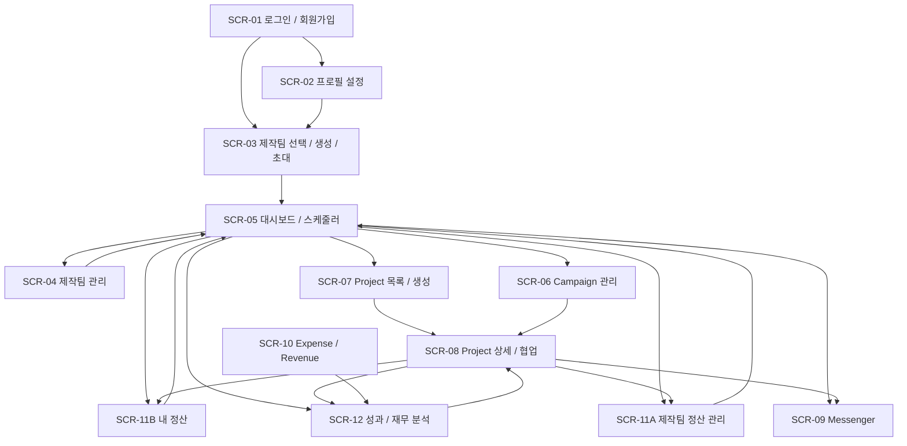

# 화면 설계

> YMS의 전체 화면 목록과 각 화면의 목적, 접근 권한, 핵심 UI 컴포넌트를 정의합니다.  
> 본 문서는 요구사항 및 사용자 시나리오를 화면 단위로 구체화한 기준 문서입니다.

> **UI 표기 기준:** 사용자에게 노출되는 화면 문구는 `제작팀`으로 통일합니다. 컴포넌트명, API 필드와 같은 내부 기술 식별자는 `Workspace` / `workspace`를 유지합니다.

## 1. 화면 설계 원칙

YMS는 **크리에이터와 편집자·썸네일 작업자 사이의 제작 협업**을 기본 가치로 하며, OWNER와 ADMIN에게는 콘텐츠 제작 비용과 실제 수익을 연결하여 성과를 분석하는 운영 기능을 추가로 제공합니다.

따라서 모든 사용자가 동일한 메뉴와 재무 정보를 보는 구조로 설계하지 않습니다.

- 일반 작업자는 자신에게 필요한 프로젝트, 작업, 일정, 채팅, 알림과 개인 정산 정보를 우선 확인합니다.
- OWNER와 ADMIN은 제작팀 운영, 채널, 캠페인, 비용, 수익, 전체 정산과 재무 분석 기능에 접근할 수 있습니다.
- 프로젝트의 EDIT / VIEW 권한은 프로젝트 협업 범위를 결정하며 제작팀 전체 재무 정보 접근 권한을 의미하지 않습니다.
- 제작팀은 로그인 이후 대부분의 화면에서 현재 작업 범위를 결정하는 기준 컨텍스트로 사용합니다.
- 데스크톱과 모바일에서 동일한 핵심 기능과 조작 체계를 제공하되, 모바일의 본문은 카드·목록 중심의 세로형 레이아웃을 우선합니다.

---

## 2. 공통 레이아웃 및 공통 UI

현재 제작팀을 작업 범위로 사용하는 인증 이후 주요 화면은 공통 `AppLayout`을 사용합니다. SCR-02 프로필 설정과 SCR-03 제작팀 선택·생성·초대는 제작팀 컨텍스트가 확정되기 전에도 접근해야 하므로 `AppLayout` 외부에 둡니다.

### 공통 헤더

- YMS 로고
- 현재 제작팀 표시 및 전환
- 주요 화면 이동 메뉴
- 읽지 않은 알림 배지
- 사용자 프로필 메뉴

제작팀 전환 메뉴에는 참여 중인 제작팀 목록과 함께 SCR-03 `/workspaces`로 이동하는 `전체 제작팀 보기` 진입점을 제공합니다. 현재 제작팀의 멤버, 채널과 업무 유형을 관리하는 기능은 SCR-03과 구분하여 `/workspace/settings`에서 제공합니다.

### 공통 내비게이션

메뉴는 화면 폭과 관계없이 다음 순서와 위치 체계를 유지합니다.

| 순서 | 메뉴 | 표시 대상 | Route | 비고 |
| --- | --- | --- | --- | --- |
| 1 | 대시보드 | 모든 제작팀 멤버 | `/dashboard` | SCR-05 |
| 2 | 캠페인 | OWNER, ADMIN | `/campaigns` | SCR-06 |
| 3 | 프로젝트 | 모든 제작팀 멤버 | `/projects` | SCR-07 |
| 4 | 메신저 | 모든 제작팀 멤버 | `/messenger` | SCR-09, 실제 대화 접근은 프로젝트 참여 권한 확인 |
| 5 | 정산 관리 `🧾` | OWNER, ADMIN | `/workspace/settlements` | SCR-11A |
| 5 | 내 정산 `💰` | MEMBER | `/my/settlements` | SCR-11B, 같은 메뉴 위치를 사용하지만 별개 기능 |
| 6 | 분석 | OWNER, ADMIN | `/analytics` | SCR-12, 관리 영역 시작 |
| 7 | 비용·수익 | OWNER, ADMIN | `/finance` | SCR-10 |
| 8 | 제작팀 관리 | OWNER, ADMIN | `/workspace/settings` | SCR-04 |

일반 업무 영역과 관리 영역은 각각 둥근 테두리를 가진 메뉴 그룹으로 표시합니다. 캠페인은 관리 권한이 필요하지만 프로젝트보다 상위 업무 흐름이므로 일반 업무 메뉴 그룹에 둡니다.

역할에 허용되지 않은 메뉴는 표시하지 않되, 숨김 처리를 보안 수단으로 사용하지 않고 Route와 서버에서도 권한을 검증합니다. 현재 Route에 해당하는 메뉴에는 활성 상태와 `aria-current`를 제공합니다.

미구현 화면도 위 Route를 선점하고 `AppLayout` 안에서 다음 공통 준비 중 상태를 표시합니다.

> **{기능명}, 지금 열심히 편집 중이에요 🎬**<br>
> 메뉴와 가는 길은 먼저 열어 두었어요. 완성되는 대로 멋지게 선보일게요.

준비 중 화면에는 `대시보드로 이동` 버튼을 제공하며 별도 뒤로 가기 버튼은 제공하지 않습니다.

### 공통 알림 Drawer

별도의 전체 화면으로 분리하지 않고 모든 인증 화면에서 열 수 있는 Drawer 또는 Popover 형태로 제공합니다.

표시 대상:

- 새 작업 배정
- 작업 상태 변경 및 검수 요청
- 프로젝트 채팅 메시지
- 제작팀 초대
- 개인 정산 상태 변경

기능:

- 전체 / 읽지 않음 필터
- 최근 알림 목록
- 읽음 처리
- 관련 프로젝트 또는 화면 이동

### 공통 반응형 원칙

- 데스크톱: 좌우 분할, 테이블, 월간 캘린더 등 넓은 화면 활용
- 모바일: 카드, 주간 일정 또는 Agenda View, 단일 컬럼 중심
- 공통 헤더는 데스크톱과 모바일 모두 제작팀·알림·사용자 영역과 업무 메뉴 영역으로 구성된 동일한 2단 구조를 유지
- 모바일에서도 주요 메뉴를 별도 햄버거 메뉴나 Drawer 안에 숨기지 않고 동일한 메뉴 행과 순서를 유지
- 화면 폭보다 긴 메뉴 행은 가로로 탐색할 수 있게 하고, 현재 활성 메뉴가 보이지 않으면 보이는 위치로 자동 이동
- 메뉴 이름과 아이콘은 화면 크기에 따라 다른 의미나 위치 체계로 변경하지 않으며 모바일 터치 영역을 충분히 확보
- 수정 권한이 없는 사용자는 단순히 버튼을 숨기는 것에 그치지 않고 서버에서도 권한을 검증합니다.

### 공통 접근 불가 및 리소스 확인 상태

사용자가 URL, 알림 또는 저장된 링크로 특정 기능에 직접 접근했으나 현재 제작팀에서 이용할 수 없는 경우 자동으로 다른 화면으로 보내지 않고 다음 전용 상태를 표시합니다.

> **이 기능을 이용할 수 없어요**<br>
> 현재 선택된 제작팀은 ‘{제작팀명}’입니다.<br>
> 다른 제작팀에서 이용하려던 기능이라면 제작팀을 전환해 주세요.

`제작팀 전환`과 `대시보드로 이동` 동작을 함께 제공합니다. 화면을 사용하는 동안 역할이 변경되어 API가 403을 반환한 경우에도 같은 상태를 사용합니다.

다른 제작팀 소속 리소스를 열었거나 권한과 리소스 존재 여부를 구체적으로 구별해서는 안 되는 경우에는 다음 상태를 사용합니다.

> **현재 제작팀에서는 이 항목을 찾을 수 없어요**<br>
> 현재 선택된 제작팀은 ‘{제작팀명}’입니다.

이 상태에는 `제작팀 전환`과 `{기능명} 목록으로 이동` 동작을 제공합니다. 두 상태는 같은 공통 컴포넌트를 사용하고 제목, 설명과 보조 이동 경로만 상태에 맞게 변경합니다.

### 인증 후 보호 라우팅 원칙

존재하는 Route에 직접 접근하거나 새로고침한 경우 다음 순서로 상태를 검증합니다.

1. 인증 여부
2. `profileSetupRequired`에 따른 프로필 설정 완료 여부
3. Workspace 목록 조회 및 저장된 Workspace 접근 권한
4. 현재 탭의 Workspace 선택 여부

전문 역할을 나타내는 `roles` 배열은 프로필 설정 완료 여부의 대체 기준으로 사용하지 않습니다.

| 접근 조건 | 이동 결과 |
| --- | --- |
| 비인증 사용자가 보호 화면 접근 | SCR-01 `/` |
| 프로필 설정이 필요한 사용자가 SCR-03 또는 Workspace 하위 화면 접근 | SCR-02 `/profile-setup` |
| 프로필 설정 완료 후 현재 Workspace가 없는 사용자가 Workspace 하위 화면 접근 | SCR-03 `/workspaces` |
| 유효한 현재 Workspace가 있는 사용자가 `/` 접근 | SCR-05 `/dashboard` |
| 인증된 사용자가 `/profile-setup` 접근 | 프로필 조회·수정 화면 허용 |
| 프로필 설정을 완료한 사용자가 `/workspaces` 접근 | 제작팀 선택·생성·초대 화면 허용 |
| 역할상 허용되지 않은 Workspace 기능 Route에 직접 접근 | 현재 제작팀을 표시하는 공통 접근 불가 화면 |
| 현재 제작팀에 속하지 않은 상세 리소스 접근 | 존재 여부를 노출하지 않는 공통 리소스 확인 상태 |
| 존재하지 않는 URL 접근 | 인증 상태와 관계없이 404 화면 |

비인증 사용자가 보호 URL로 직접 접근했더라도 로그인 후 원래 URL로 복귀시키지 않습니다. 항상 프로필 설정, Workspace 선택, Dashboard 순서의 표준 진입 흐름을 적용하며 별도의 `returnUrl`은 저장하지 않습니다.

Workspace 목록과 저장된 선택값을 검증하는 동안에는 빈 화면이나 중간 리다이렉트를 노출하지 않습니다. 애니메이션과 `제작팀 정보를 확인하고 있습니다.` 문구가 포함된 전용 진행 상태를 즉시 표시하고, 응답이 도착하면 인위적인 최소 대기 시간 없이 다음 화면으로 전환합니다.

Workspace 목록 조회 실패는 참여 Workspace가 없는 상태로 간주하지 않습니다. 전용 오류 상태와 `다시 시도` 동작을 제공하고, 재시도 중에는 버튼을 비활성화한 뒤 `다시 확인하는 중...`처럼 진행 상태를 명확히 표시합니다.

### 브라우저 세션 및 Workspace 복원 정책

- 같은 브라우저에서는 하나의 로그인 계정만 사용하며 인증 상태를 모든 탭이 공유합니다.
- 인증 상태는 브라우저 공용 저장소에 보관하여 브라우저를 다시 열어도 로그아웃 또는 토큰 만료 전까지 복원합니다.
- 로그인, 로그아웃과 인증 만료는 모든 탭에 전파합니다.
- 로그아웃 시 모든 탭의 인증 상태와 탭별 현재 Workspace를 제거하되, 사용자별 마지막 Workspace ID는 유지합니다.
- 각 탭의 현재 Workspace는 탭 세션 저장소에 보관하여 독립적으로 유지합니다. 한 탭의 일반적인 Workspace 전환이 이미 열린 다른 탭의 현재 Workspace를 변경해서는 안 됩니다.
- Workspace를 선택하면 현재 탭의 선택값과 사용자별 마지막 선택값을 함께 갱신합니다.
- 사용자별 마지막 Workspace ID는 브라우저 공용 저장소에 보관하고, 새 탭 또는 다음 브라우저 방문에서 복원 후보로 사용합니다.
- 복원 후보는 Workspace 목록에서 현재 접근 권한이 확인된 경우에만 현재 Workspace로 사용합니다.
- 저장값이 없거나 권한이 사라졌으면 첫 번째 Workspace를 자동 선택하지 않고 SCR-03으로 이동합니다.
- 권한 상실이 확인되면 해당 Workspace를 사용하는 모든 탭에 무효 상태를 전파하고 SCR-03으로 이동합니다. 다른 Workspace를 사용 중인 탭에는 영향을 주지 않습니다.
- 무효화된 Workspace가 사용자별 마지막 선택값이면 해당 저장값도 제거합니다.

### Workspace 전환 시 Route 처리

- 목록 화면에서 제작팀을 전환하면 새 제작팀의 같은 기능 목록 Route를 유지합니다.
- 상세 화면에서 제작팀을 전환하면 이전 제작팀의 리소스 ID와 선택 상태를 제거하고 새 제작팀의 같은 기능 목록 Route로 이동합니다.
- 새 제작팀에도 적용 가능한 검색과 필터 상태는 가능한 범위에서 유지합니다.
- 전환 완료 시 `{제작팀명} 제작팀으로 전환했습니다.`라는 정보성 안내만 표시하고 권한 부족 또는 이전 리소스 부재를 전환 메시지로 설명하지 않습니다.
- 새 제작팀에서 현재 기능을 사용할 수 없으면 Route를 유지하고 공통 접근 불가 화면을 표시합니다.
- 역할에 따라 같은 메뉴 위치를 공유하는 서로 다른 기능으로 자동 이동하지 않습니다. 예를 들어 `/workspace/settlements`에서 MEMBER인 제작팀으로 전환해도 `/my/settlements`로 자동 전환하지 않습니다.

---

## 3. 전체 화면 목록

| 화면 ID | 화면명 | 주요 사용자 | 핵심 목적 |
| --- | --- | --- | --- |
| SCR-01 | 로그인 / 회원가입 | 비인증 사용자 | 계정 생성 및 로그인 |
| SCR-02 | 프로필 설정 | 인증 사용자 | 전문 역할 및 개인 기본 설정 |
| SCR-03 | 제작팀 선택 / 생성 / 초대 | 인증 사용자 | 사용할 제작팀 진입 |
| SCR-04 | 제작팀 관리 | OWNER, ADMIN | 멤버와 채널 관리 |
| SCR-05 | 메인 대시보드 및 스케줄러 | 제작팀 멤버 | 개인 업무와 전체 일정 확인 |
| SCR-06 | 캠페인 관리 | OWNER, ADMIN | 여러 프로젝트를 캠페인 단위로 관리 |
| SCR-07 | 프로젝트 목록 / 생성 / 보관함 | 제작팀 멤버 | 프로젝트 탐색 및 생성 |
| SCR-08 | 프로젝트 상세 및 협업 | 프로젝트 참여자, 관리 권한 사용자 | 작업, 검수, 권한, YouTube 연결 등 프로젝트 업무 수행 |
| SCR-09 | 실시간 협업 메신저 | 프로젝트 참여자 | 참여 프로젝트의 채팅 통합 관리 |
| SCR-10 | 비용 / 수익 관리 | OWNER, ADMIN | Expense와 Revenue 등록 및 조회 |
| SCR-11A | 제작팀 정산 관리 | OWNER, ADMIN | 제작팀 전체 정산 생성, 확정 및 지급 현황 관리 |
| SCR-11B | 내 정산 | MEMBER 본인 | 자신의 지급 대상 작업과 정산 상태 확인 |
| SCR-12 | 콘텐츠 성과 및 재무 분석 | OWNER, ADMIN | Project / Campaign 중심 실제 재무 성과 분석 |

---

# SCR-01. 로그인 / 회원가입

> 와이어프레임: [GitHub Pages에서 보기](https://heebaek200.github.io/yms-project/design/wireframes/scr-01-auth.html)

## 목적

사용자가 YMS 계정을 생성하거나 기존 계정으로 로그인합니다.

## 접근 권한

- 모든 비인증 사용자
- 인증 완료 사용자는 기본 진입 화면으로 이동

## 핵심 컴포넌트

### 로그인 탭

- 이메일 입력
- 비밀번호 입력
- 로그인 버튼
- 입력값 오류 메시지

### 회원가입 탭

- 이메일 입력
- 비밀번호 입력
- 비밀번호 확인
- 이름 또는 닉네임
- 회원가입 버튼
- 입력값 오류 메시지

### 추후 확장 영역

- Google 로그인 버튼
- 기타 소셜 로그인 버튼

초기 릴리스에서는 소셜 로그인 버튼을 비활성 상태로 표시하거나 UI에서 제외할 수 있습니다.

## 주요 상태 및 검증

- 이메일 형식 오류
- 비밀번호 길이 및 허용 형식 오류
- 비밀번호 확인 불일치
- 이미 사용 중인 이메일
- 로그인 실패
- 인증 만료

## 화면 이동

```text
회원가입 성공
    ↓
SCR-02 프로필 설정

로그인 성공
    ↓
프로필 설정 필요 여부 확인
    ├─ 설정 필요 → SCR-02 프로필 설정
    └─ 설정 완료 → 마지막 Workspace 접근 권한 확인
                       ├─ 유효함 → SCR-05 대시보드
                       └─ 없거나 무효함 → SCR-03 제작팀 선택 / 생성 / 초대
```

---

# SCR-02. 프로필 설정

> 와이어프레임: [GitHub Pages에서 보기](https://heebaek200.github.io/yms-project/design/wireframes/scr-02-profile.html)

## 목적

사용자가 자신이 수행할 수 있는 전문 역할과 개인 기본 정보를 설정합니다.

CREATOR 역할 사용자는 YouTube 플랫폼 예상 수익 계산에 사용할 기본 조회수 1회당 수익 단가를 설정할 수 있습니다.

## 접근 권한

- 인증된 사용자
- 자신의 프로필만 수정 가능

## 핵심 컴포넌트

### 기본 프로필

- 이메일 표시
- 이름 / 닉네임 입력

### 전문 역할 선택

복수 선택 가능:

- CREATOR
- EDITOR
- THUMBNAILER

### CREATOR 전용 수익 단가 설정

CREATOR 역할을 선택한 경우에만 표시합니다.

- 롱폼 기본 조회수 1회당 수익 단가
- 쇼츠 기본 조회수 1회당 수익 단가
- 기존 미확정 프로젝트 적용 범위 선택
  - 향후 프로젝트만
  - 기존 미확정 프로젝트에도 적용

단가 입력 필드에는 기본값으로 오해할 수 있는 숫자 플레이스홀더를 사용하지 않습니다. 대신 다음 참고 안내를 입력 영역과 분리하여 표시합니다.

- 처음 설정할 때 참고할 수 있는 예시입니다.
- 롱폼 약 3.00원/조회 · 쇼츠 약 0.20원/조회
- 채널과 콘텐츠에 따라 실제 수익은 달라질 수 있습니다.

사용자는 숫자 뒤에 `원` 또는 `원/조회`를 입력하거나 올바른 천 단위 쉼표를 사용할 수 있습니다. 입력 필드가 포커스를 잃으면 화면은 단위와 쉼표를 제거한 숫자 문자열로 정규화하며, 임의 문자가 섞인 값은 자동 변환하지 않고 검증 오류로 표시합니다.

롱폼 또는 쇼츠 단가를 입력하지 않으면 해당 항목은 0원으로 저장합니다.

프로필의 단가는 프로젝트 생성 시 사용할 기본값이며 프로젝트에 실제 적용된 단가는 별도로 저장합니다.

## 주요 상태 및 검증

- 전문 역할 미선택
- CREATOR 단가 미입력 시 0원으로 저장
- 음수 또는 숫자가 아닌 단가
- 허용 범위를 벗어난 단가
- CREATOR 역할 해제 시 단가 입력 영역 숨김
- 기본 단가 변경 시 기존 프로젝트 자동 변경 금지

## 화면 이동

설정 완료 후 SCR-03으로 이동합니다.

---

# SCR-03. 제작팀 선택 / 생성 / 초대

> 와이어프레임: [GitHub Pages에서 보기](https://heebaek200.github.io/yms-project/design/wireframes/scr-03-workspace.html)

## 목적

사용자가 참여 중인 제작팀을 선택하거나 새 제작팀을 만들고, 자신에게 도착한 초대를 처리합니다.

YMS의 주요 업무 화면은 제작팀을 선택한 이후 진입합니다.

## 접근 권한

- 인증되고 프로필 설정을 완료한 사용자

## 핵심 컴포넌트

### 참여 제작팀 목록

각 카드에 다음 정보를 표시합니다.

- 제작팀명
- 자신의 권한: OWNER / ADMIN / MEMBER
- 참여 중인 프로젝트 수
- 최근 접근 시각 또는 최근 활동

### 제작팀 생성

- 새 제작팀 생성 버튼
- 제작팀명 입력
- 설명 등 기본 정보 입력

생성한 사용자는 자동으로 OWNER가 됩니다.

### 초대 목록

- 초대받은 제작팀명
- 초대한 사용자
- 초대 상태
- 초대 발송 시각
- 수락
- 거절

## 주요 상태 및 검증

- 유효하지 않거나 취소·만료된 초대
- 이미 참여 중인 제작팀 초대
- 가입 전 이메일로 발송된 초대 연결
- 참여 가능한 제작팀이 없는 사용자
- 저장된 마지막 Workspace가 없거나 현재 접근할 수 없는 사용자
- Workspace 목록 조회 중인 사용자
- Workspace 목록 조회에 실패하여 재시도가 필요한 사용자

## 화면 이동

제작팀을 선택하면 SCR-05 메인 대시보드로 이동합니다.

---

# SCR-04. 제작팀 관리

> 와이어프레임: [GitHub Pages에서 보기](https://heebaek200.github.io/yms-project/design/wireframes/scr-04-workspace-admin.html)

## 목적

제작팀의 멤버와 YouTube 채널을 관리합니다.

제작팀 관리 기능과 프로젝트 협업 기능을 분리하여 일반 작업자에게 불필요한 관리 UI가 노출되지 않도록 합니다.

## 접근 권한

- OWNER
- ADMIN

일반 MEMBER는 접근할 수 없습니다.

## 핵심 컴포넌트

제작팀 관리의 하위 영역은 `/workspace/settings`를 공통 Route로 사용하고 Query Parameter로 선택 탭을 유지합니다.

- 멤버 관리: `/workspace/settings?tab=members`
- 채널 관리: `/workspace/settings?tab=channels`
- 작업 종류 관리: `/workspace/settings?tab=task-types`

탭 선택은 새로고침과 직접 URL 접근 후에도 유지합니다. Query Parameter가 없거나 알 수 없는 `tab` 값이면 `channels`로 보정합니다. `members` 탭의 실제 기능은 #35에서 구현합니다.

### 멤버 관리 탭

- 멤버 목록
- 이름
- 이메일
- 전문 역할
- 제작팀 권한
- 초대 상태
- 권한 변경
- 멤버 제외
- 새 멤버 초대

### 멤버 초대 모달

- 이메일 입력
- 초대 발송
- 대기 중 초대 목록
- 초대 재전송
- 초대 취소

### 채널 관리 탭

- 등록 채널 목록
- 채널명
- YouTube Channel ID / URL
- 설명
- YouTube 연동 상태
- 활성 / 비활성 상태
- 채널 추가
- 채널 수정
- 채널 삭제

채널 등록과 수정 시 채널명만 필수로 입력합니다. YouTube Channel ID, URL과 설명은 선택값이며, 이름만으로 수동 등록할 수 있습니다. ID나 URL이 입력되어 있어도 실제 연동 절차를 완료하기 전에는 `연동됨`으로 표시하지 않습니다.

연동 상태는 `수동 등록(MANUAL)`, `연동됨(CONNECTED)`, `연동 오류(ERROR)`를 목록에서 서로 구분합니다. 실제 연동을 해제한 이력을 나타내는 `DISCONNECTED`는 API와 데이터 모델에 유지하되, #36 Mock 화면은 앞의 세 상태를 모두 제공하여 표시를 검증합니다.

채널은 비활성화하거나 다시 활성화할 수 있습니다. 비활성 채널은 기존 프로젝트 이력에는 유지하지만 신규 프로젝트 생성과 일반 선택 목록에서는 제외합니다.

활성 채널에는 `수정`, `비활성화`, `관리에서 제거`를 표시하고 비활성 채널에는 `수정`, `재활성화`, `관리에서 제거`를 표시합니다. 버튼 문구는 줄바꿈하지 않고 공간이 부족할 때 버튼 전체가 다음 줄로 이동합니다. 제거 확인 모달에는 YouTube의 실제 채널은 삭제되지 않고 YMS에 등록한 채널 정보만 제거된다는 점과 되돌릴 수 없다는 점을 명시합니다. 서버 확인 결과 기존 프로젝트나 채널 귀속 업무 데이터에서 사용 중이면 해당 카드에 제거 불가 사유와 비활성화 안내를 표시하며, 연결 이력이 없으면 목록에서 제거합니다.

### 작업 종류 관리 영역

화면에서는 확장 가능한 Task Type을 `작업 종류`로 표시하여 제작팀에서 관리합니다.

- 기본 작업 종류
- 사용자 정의 작업 종류
- 새 작업 종류 추가
- 사용 여부 활성 / 비활성
- 작업 종류 삭제

가편집, 종합 편집, 자막과 썸네일은 초기 제공 데이터이며 사용자 정의 작업 종류와 동일하게 이름 수정과 비활성화가 가능합니다.

작업 종류 이름은 앞뒤 공백을 제거하고 영문 대소문자를 구분하지 않은 값을 기준으로 제작팀 안에서 중복을 차단합니다. 같은 이름의 비활성 작업 종류가 있으면 새 항목을 만들지 않고 기존 항목의 재활성화를 안내합니다.

비활성화된 작업 종류는 다시 활성화할 수 있습니다. 신규 작업 생성 목록에서는 제외하되 기존 작업 이력에는 유지합니다.

활성 작업 종류에는 `수정`, `비활성화`, `삭제`를 표시하고 비활성 작업 종류에는 `수정`, `재활성화`, `삭제`를 표시합니다. 세 버튼은 카드 안에서 같은 줄을 유지합니다. 삭제 전에는 되돌릴 수 없다는 확인 대화상자를 표시합니다. 서버 확인 결과 기존 작업에서 사용 중이면 해당 카드에 삭제 불가 사유와 비활성화 안내를 표시하며, 사용 이력이 없으면 목록에서 제거합니다.

### 관리 폼 이탈과 제작팀 전환

생성·수정 모달에서 입력값이 초기값과 달라진 경우 다음 동작 전에 확인 대화상자를 표시합니다.

- 모달 닫기
- 바깥 영역 클릭이나 `Escape` 입력 등 모달 닫기와 같은 결과를 만드는 동작
- 다른 관리 탭 선택
- 헤더에서 다른 제작팀으로 전환하는 동작
- 현재 화면을 벗어나는 내비게이션

사용자가 이탈을 승인하면 미저장 입력값을 별도로 보관하지 않고 폐기합니다. 변경이 없거나 저장을 완료한 상태에서는 확인 없이 닫거나 제작팀을 전환합니다. 제작팀 전환이 확정되면 열린 모달을 닫고 새 제작팀의 관리 데이터를 조회합니다.

## 주요 상태 및 검증

- 마지막 OWNER의 권한 변경 또는 제거 차단
- 이미 참여 중인 멤버 재초대 차단
- 취소된 초대 처리
- 다른 제작팀 리소스 접근 차단
- 프로젝트나 채널 귀속 업무 데이터에서 사용 중인 채널은 삭제를 거부하고 비활성화 안내

---

# SCR-05. 메인 대시보드 및 스케줄러

> 와이어프레임: [GitHub Pages에서 보기](https://heebaek200.github.io/yms-project/design/wireframes/scr-05-dashboard.html)

## 목적

사용자가 로그인 후 가장 자주 확인하는 업무 화면입니다.

현재 제작팀에서 자신의 작업, 프로젝트 일정, 검수 요청, 마감 임박 업무와 알림을 한눈에 확인합니다.

## 접근 권한

- 현재 제작팀의 모든 멤버

사용자의 권한에 따라 카드와 관리 기능의 노출 범위를 다르게 구성합니다.

## 핵심 컴포넌트

### 요약 카드

공통 또는 사용자 중심:

- 진행 중 프로젝트 수
- 내가 담당한 마감 예정 작업 수
- 검수 요청 작업 수
- 마감 임박 작업 수

일반 작업자는 자신의 작업 중심으로 표시합니다.

OWNER / ADMIN은 제작팀 운영 현황과 SCR-12 분석 화면으로 이동할 수 있는 링크를 추가로 제공합니다.

### 스케줄러

데스크톱:

- 월간 Calendar View
- 작업 기간 막대 표시

모바일:

- 주간 Calendar 또는 Agenda View
- 날짜별 작업 목록

### FilterBar

- 조회 기간
- 프로젝트 상태
- 전문 역할
- 내 작업만 보기
- 채널
- 프로젝트 / 작업 키워드 검색

### 업무 및 알림 피드

- 오늘 마감 작업
- 마감 임박 작업
- 검수 요청
- 최근 알림

## 주요 상태 및 검증

- 조회 결과 없음
- 필터 조합 결과 없음
- 권한에 따라 다른 프로젝트 노출
- 보관된 프로젝트의 기본 일정 제외
- CANCELLED 프로젝트의 기본 일정 제외

## 화면 이동

- 일정 선택 → SCR-08 프로젝트 상세
- 새 프로젝트 → SCR-07 프로젝트 생성
- 알림 선택 → 관련 프로젝트 또는 정산 화면

---

# SCR-06. 캠페인 관리

> 와이어프레임: [GitHub Pages에서 보기](https://heebaek200.github.io/yms-project/design/wireframes/scr-06-campaign.html)

## 목적

여러 영상 프로젝트를 하나의 계약, 프로모션 또는 비즈니스 목적 단위로 묶어 관리합니다.

Campaign은 제작팀 소속이며 특정 Channel을 직접 소유하지 않습니다.

## 접근 권한

- OWNER
- ADMIN

## 핵심 컴포넌트

### 캠페인 목록

- 캠페인명
- 상태
- 시작일
- 종료일
- 연결 프로젝트 수
- 실제 비용 요약
- 실제 수익 요약

### 필터

- 상태
- 기간
- 키워드

### 캠페인 생성 / 수정 모달

- 캠페인명
- 설명
- 시작일
- 종료일
- 상태
  - PLANNING
  - ACTIVE
  - COMPLETED
  - CANCELLED

### 캠페인 상세 영역

- 연결된 프로젝트 목록
- 각 프로젝트의 채널
- 각 프로젝트 상태
- 캠페인 직접 Expense 요약
- 캠페인 직접 Revenue 요약
- 콘텐츠 가치 분석 바로가기

## 주요 상태 및 검증

- 하나의 프로젝트는 최대 하나의 Campaign에만 연결
- Campaign 없이 존재하는 Project 허용
- 서로 다른 Channel의 Project를 하나의 Campaign에 포함 가능
- Project가 연결된 Campaign의 즉시 삭제 제한
- 완료 또는 취소 Campaign의 이력 보존

## 화면 이동

- 프로젝트 선택 → SCR-08
- 성과 분석 → SCR-12

---

# SCR-07. 프로젝트 목록 / 생성 / 보관함

> 와이어프레임: [GitHub Pages에서 보기](https://heebaek200.github.io/yms-project/design/wireframes/scr-07-projects.html)

## 목적

현재 제작팀의 영상 프로젝트를 탐색하고 새 프로젝트를 생성하며 완료·취소 후 보관된 프로젝트를 조회합니다.

## 접근 권한

- 제작팀 멤버
- 조회 범위는 제작팀 및 프로젝트 권한에 따라 제한
- 프로젝트 생성 버튼은 생성 권한이 있는 사용자에게만 노출

## 핵심 컴포넌트

### 프로젝트 목록

- 프로젝트 제목
- 채널
- Campaign
- 프로젝트 상태
- 제작 마감일
- 업로드 예정일
- 주요 참여자
- 진행률

### 검색 및 필터

- 상태
- 채널
- Campaign
- 참여 여부
- 보관 여부
- 키워드

### 프로젝트 생성 / 수정 모달 또는 화면

- 프로젝트 제목
- 기획 내용
- 채널
- Campaign 선택
- 제작 마감일
- 업로드 예정일
- 초기 프로젝트 상태

Campaign은 선택값입니다.

### 보관함

- 완료 프로젝트
- 취소 프로젝트
- 보관 해제

## 주요 상태 및 검증

- 다른 제작팀의 Channel 선택 차단
- 다른 제작팀의 Campaign 선택 차단
- Campaign 미선택 허용
- 삭제 전 확인
- 삭제 또는 보관된 프로젝트의 일반 목록 제외

---

# SCR-08. 프로젝트 상세 및 협업

> 와이어프레임: [GitHub Pages에서 보기](https://heebaek200.github.io/yms-project/design/wireframes/scr-08-project-detail.html)

## 목적

YMS 협업 기능의 핵심 화면입니다.

프로젝트 참여자가 프로젝트 정보, 작업 배정, 일정, 검수, 참여자 권한, YouTube 영상 연결과 프로젝트 채팅을 한 화면에서 관리합니다.

## 접근 권한

- 프로젝트 소유자
- 프로젝트 참여자
- 필요한 제작팀 관리 권한 사용자

프로젝트 권한:

- EDIT: 프로젝트 및 작업 수정 가능
- VIEW: 조회 및 채팅 가능, 프로젝트와 작업 수정 불가

## 핵심 컴포넌트

### 프로젝트 기본 정보

- 프로젝트 제목
- Channel
- Campaign
- 기획 내용
- 프로젝트 상태
- 제작 마감일
- 업로드 예정일
- 실제 업로드 일시
- 보관 여부

### 참여자 및 권한 관리

- 참여자 목록
- 전문 역할
- EDIT / VIEW
- 참여자 추가
- 권한 변경
- 참여자 제거

참여자는 현재 제작팀 멤버 중에서 선택합니다.

### 작업 목록

각 작업 표시 항목:

- 작업 종류
- 담당자
- 시작일
- 종료일
- 작업자 지급 금액
- 상태
  - WAITING
  - PROGRESS
  - REVIEW
  - COMPLETED

기능:

- 작업 추가
- 작업 수정
- 담당자 변경
- 상태 변경
- 검수 요청
- 검수 완료
- 검수 반려 → PROGRESS 복귀

### YouTube 영상 연결 영역

Project의 별도 독립 화면이 아니라 프로젝트 상세에서 모달 또는 Section으로 제공합니다.

입력:

- YouTube URL 또는 Video ID
- 조회수 1회당 적용 수익 단가 방식
  - 프로필 기본 단가
  - 프로젝트 개별 단가
  - 수익 창출 없음

기능:

- 영상 유효성 확인
- 동일 영상 중복 연결 확인
- 데이터 동기화
- 실제 업로드 일시 반영
- 마지막 동기화 시각 표시

### 프로젝트 채팅 패널

데스크톱에서는 우측 고정 또는 분할 패널로 제공할 수 있습니다.

- 최근 메시지
- 실시간 송수신
- 읽지 않은 메시지
- 이전 메시지 추가 조회
- SCR-09 전체 메신저로 이동

## 주요 상태 및 검증

- 비참여 사용자 접근 시 403
- VIEW 사용자의 수정 요청 차단
- 프로젝트 비참여자를 작업 담당자로 지정 불가
- 작업 역할 불일치 시 경고 후 배정 허용
- 작업 종료일 < 시작일 저장 차단
- 작업 종료일 > 프로젝트 마감일 경고
- 검수 반려 및 재검수
- 잘못된 YouTube URL / Video ID
- YouTube API 오류와 입력 오류 구분
- 동일 영상의 다른 Project 중복 연결 차단

---

# SCR-09. 실시간 협업 메신저

> 와이어프레임: [GitHub Pages에서 보기](https://heebaek200.github.io/yms-project/design/wireframes/scr-09-messenger.html)

## 목적

사용자가 참여 중인 여러 프로젝트의 채팅을 하나의 화면에서 확인하고 전환할 수 있도록 합니다.

SCR-08의 프로젝트별 채팅 패널과 동일한 메시지 데이터를 공유합니다.

## 접근 권한

- 인증 사용자
- 현재 사용자가 참여 중인 프로젝트 채팅방만 표시

EDIT와 VIEW 모두 채팅에 참여할 수 있습니다.

## 핵심 컴포넌트

### 채팅방 목록

- 프로젝트명
- 최근 메시지 요약
- 마지막 메시지 시각
- 읽지 않은 메시지 배지
- 검색

### 활성 채팅방

- 프로젝트명
- 프로젝트 바로가기
- 참여자 목록
- 과거 메시지
- 실시간 신규 메시지
- 메시지 입력
- 전송

### 모바일 화면

활성화된 채팅방이 없을 때:

- 채팅방 목록 전체 화면

채팅방을 선택한 뒤:

- 활성 채팅방 전체 화면
- 목록으로 돌아가기

## 주요 상태 및 검증

- 프로젝트에서 제외된 사용자의 채팅 접근 차단
- 읽음 위치 갱신
- 비활성 채팅방 메시지 수신 시 목록 및 unread 배지 갱신
- 오래된 메시지 추가 조회
- WebSocket 연결 실패 시 오류 안내 및 재연결 처리

---

# SCR-10. 비용 / 수익 관리

> 와이어프레임: [GitHub Pages에서 보기](https://heebaek200.github.io/yms-project/design/wireframes/scr-10-finance.html)

## 목적

OWNER와 ADMIN이 제작팀의 Expense와 Revenue를 기록하고 각 금액이 어느 업무 단위에서 발생했는지 관리합니다.

실제 재무 데이터의 입력 화면이며 조회수 기반 예상 수익과 구분합니다.

## 접근 권한

- OWNER
- ADMIN

## 핵심 컴포넌트

### Expense 탭

목록:

- 비용 유형
- 금액
- 발생일
- 귀속 단위
- 귀속 대상
- 설명

등록 / 수정:

- 비용 유형
- 금액
- 발생일
- 귀속 단위 선택
  - Project
  - Campaign
  - Channel
  - 제작팀
- 귀속 대상 선택
- 메모

### Revenue 탭

목록:

- 수익 유형
- 실제 금액
- 발생일 또는 정산 기준일
- 귀속 단위
- 귀속 대상
- 설명

수익 유형:

- YOUTUBE_PLATFORM
- SPONSORSHIP
- AFFILIATE
- MERCHANDISE
- MEMBERSHIP
- OTHER

### 필터

- 기간
- Expense / Revenue
- 유형
- 귀속 단위
- Channel
- Campaign
- Project

## 주요 상태 및 검증

- 하나의 Expense는 하나의 대상에만 직접 귀속
- 하나의 Revenue는 하나의 대상에만 직접 귀속
- 다른 제작팀의 대상 연결 차단
- 작업자 지급액을 Expense로 중복 집계하지 않도록 안내
- 음수 금액 입력 차단
- 상위 단위 수익 또는 비용을 하위 단위에 자동 배분하지 않음

---

# SCR-11A. 제작팀 정산 관리

> 와이어프레임: [GitHub Pages에서 보기](https://heebaek200.github.io/yms-project/design/wireframes/scr-11-settlement.html)

## 목적

제작팀 전체 작업자의 작업 지급 금액을 기간별로 집계하고 정산 생성, 확정과 지급 완료 상태를 관리합니다.

개인 정산 조회와 화면, Route 및 조회 로직을 공유하지 않는 별개의 관리 기능으로 제공합니다.

## Route

`/workspace/settlements`

## 접근 권한

- OWNER
- ADMIN

## 핵심 컴포넌트

### 정산 목록

- 정산 기간
- 작업자
- 포함 작업 수
- 지급 금액
- 정산 상태
  - DRAFT
  - CONFIRMED
  - PAID

### 정산 상세

- 포함 작업 목록
- Project
- 작업 종류
- 완료일
- 지급 금액
- 합계
- 상태 변경

### DRAFT 기능

- 최신 작업 정보로 재계산
- 지급 대상 확인
- CONFIRMED 확정

### CONFIRMED 기능

- 확정 시점 스냅샷 표시
- PAID 처리

## 주요 상태 및 검증

- 취소 Project의 완료 작업도 지급 대상으로 포함 가능
- 동일 작업의 중복 정산 차단
- DRAFT는 재계산 가능
- CONFIRMED 이후 작업 금액 변경 자동 반영 금지
- PAID 일반 수정 차단

---

# SCR-11B. 내 정산

> 와이어프레임: [GitHub Pages에서 보기](https://heebaek200.github.io/yms-project/design/wireframes/scr-11-settlement.html)

## 목적

현재 사용자가 자신에게 지급될 작업 금액과 정산 상태를 확인합니다.

제작팀 정산 관리와 화면, Route 및 조회 로직을 공유하지 않는 별개의 개인 기능으로 제공합니다. 금액 표시, 상태 배지와 기간 입력처럼 접근 범위와 무관한 표현 컴포넌트만 공통으로 사용할 수 있습니다.

## Route

`/my/settlements`

## 접근 권한

- 현재 제작팀의 MEMBER 본인

OWNER 또는 ADMIN을 개인 정산 화면으로 자동 전환하지 않습니다. 향후 관리 권한 사용자의 개인 정산 조회 필요성이 확정되면 별도 접근 정책으로 추가합니다.

## 핵심 컴포넌트

- 정산 기간
- 자신의 지급 대상 작업
- 지급 확정 금액
- 정산 상태

## 주요 상태 및 검증

- 다른 작업자의 지급액 및 제작팀 전체 정산 금액 미노출
- 현재 제작팀에 속한 자신의 정산만 조회
- `/workspace/settlements` 직접 접근 시 공통 접근 불가 화면 표시

---

# SCR-12. 콘텐츠 성과 및 재무 분석

> 와이어프레임: [GitHub Pages에서 보기](https://heebaek200.github.io/yms-project/design/wireframes/scr-12-analytics.html)

## 목적

OWNER와 ADMIN이 콘텐츠에 실제로 투입한 비용과 실제 발생한 수익을 비교하고 Project와 Campaign의 재무 성과를 확인합니다.

조회수와 같은 콘텐츠 반응 지표는 재무 성과와 분리하여 참고 정보로 함께 제공합니다.

## 접근 권한

- OWNER
- ADMIN

일반 MEMBER에게 전체 비용, 매출, 손익 또는 ROI를 노출하지 않습니다.

## 핵심 컴포넌트

### 분석 단위 선택

초기 핵심 분석:

- Project
- Campaign

확장 조회:

- Channel
- 제작팀

### 재무 요약 카드

- 실제 비용
- 실제 수익
- 손익
- ROI
- 수익 / 비용 배수

계산:

```text
손익 = 실제 수익 - 실제 비용

ROI = (실제 수익 - 실제 비용) ÷ 실제 비용 × 100

수익/비용 배수 = 실제 수익 ÷ 실제 비용
```

실제 비용이 0원인 경우 ROI는 계산하지 않고 '해당 없음'으로 표시합니다.

### Project 분석

비용:

- 작업 담당자 지급 금액
- Project 직접 Expense

수익:

- Project 직접 실제 Revenue

콘텐츠 참고 지표:

- 조회수
- 좋아요
- 댓글 등 연동 가능한 지표
- 조회수 1회당 단가 기반 예상 YouTube 플랫폼 수익

예상 수익은 실제 ROI 계산에 포함하지 않습니다.

### Campaign 분석

비용:

- Campaign 직접 Expense
- 연결 Project의 작업자 지급 금액
- 연결 Project의 직접 Expense

수익:

- Campaign 직접 실제 Revenue
- 연결 Project의 직접 실제 Revenue

추가 정보:

- 포함 Project 수
- Project별 상태
- Project별 Channel
- Project별 콘텐츠 성과

Channel 또는 제작팀에 직접 귀속된 Expense / Revenue는 Campaign에 자동 배분하지 않습니다.

### 시각화

초기 버전에서는 다음 정도로 제한합니다.

- 실제 수익 / 실제 비용 비교
- 수익 유형별 구성
- Project별 비용·수익 비교
- Campaign 내 Project별 콘텐츠 성과
- 프로젝트 상태 또는 진행 현황

## 주요 상태 및 검증

- 실제 수익 0원 정상 처리
- 실제 비용 0원 시 ROI 계산 불가 처리
- 추정 수익과 실제 수익 시각적으로 구분
- Campaign과 Project의 Revenue 중복 집계 방지
- 권한 없는 사용자 접근 차단
- 외부 API 갱신 실패 시 마지막 성공 데이터와 갱신 시각 표시

---

## 4. 보조 모달 및 Drawer

별도 Route까지 필요하지 않은 기능은 각 화면에 종속된 UI로 구현합니다.

| ID | 구성요소 | 소속 화면 |
| --- | --- | --- |
| SCR-03-M01 | 제작팀 생성 모달 | SCR-03 |
| SCR-04-M01 | 멤버 초대 모달 | SCR-04 |
| SCR-04-M02 | Channel 등록 / 수정 모달 | SCR-04 |
| SCR-06-M01 | Campaign 생성 / 수정 모달 | SCR-06 |
| SCR-07-M01 | Project 생성 / 수정 | SCR-07 |
| SCR-08-M01 | 작업 생성 / 수정 모달 | SCR-08 |
| SCR-08-M02 | 프로젝트 참여자 / 권한 관리 | SCR-08 |
| SCR-08-M03 | YouTube 영상 연결 모달 | SCR-08 |
| SCR-10-M01 | Expense 등록 / 수정 모달 | SCR-10 |
| SCR-10-M02 | Revenue 등록 / 수정 모달 | SCR-10 |
| SCR-11A-M01 | 정산 확정 확인 모달 | SCR-11A |
| CMP-01 | 알림 Drawer | 공통 |

---

## 5. 주요 화면 이동 흐름



제작팀이 변경되면 SCR-04~12에서 사용하는 조회 범위도 함께 변경됩니다.

---

## 6. 기존 화면 설계와의 대응

초기 블로그 설계의 화면은 다음과 같이 재구성합니다.

| 기존 화면 | 새 화면 | 처리 |
| --- | --- | --- |
| 기존 SCR-01 로그인 / 회원가입 | SCR-01 | 구조 유지 및 현재 인증 흐름 반영 |
| 기존 SCR-02 프로필 및 채널 수익 설정 | SCR-02 + SCR-04 | 프로필과 제작팀 Channel 관리 분리 |
| 기존 SCR-03 대시보드 / 스케줄러 | SCR-05 | 제작팀, 요약 카드, 필터 확장 |
| 기존 SCR-04 프로젝트 상세 / 협업 | SCR-08 | Campaign, 확장형 작업, 검수 및 YouTube 연결 추가 |
| 기존 SCR-05 프로젝트 마감 / YouTube 연동 | SCR-08-M03 | 독립 화면 제거, Project 상세 하위 모달로 변경 |
| 기존 SCR-06 종합 통계 / 성과 분석 | SCR-12 | 실제 Expense / Revenue 기반으로 전면 재설계 |
| 기존 SCR-07 실시간 메신저 | SCR-09 | 기존 구조 유지, 제작팀 및 unread 규칙 보완 |

새로 추가된 주요 화면:

- SCR-03 제작팀 선택 / 생성 / 초대
- SCR-04 제작팀 관리
- SCR-06 Campaign 관리
- SCR-07 Project 목록 / 보관함
- SCR-10 Expense / Revenue 관리
- SCR-11A 제작팀 정산 관리
- SCR-11B 내 정산

---

## 7. HTML 와이어프레임 관리 규칙

화면 와이어프레임은 정적 이미지가 아니라 **최소한의 HTML과 공통 CSS로 작성한 구조 설계도**를 기준으로 관리합니다.

실제 서비스 디자인, JavaScript 동작, API 호출, 캘린더·차트·WebSocket 라이브러리는 구현하지 않습니다. 화면 영역, 정보 배치, 반응형 구조와 주요 컴포넌트의 위치를 검토할 수 있는 수준까지만 표현합니다.

파일은 다음 경로에서 관리합니다.

```text
docs/
└─ design/
   ├─ 화면 설계.md
   └─ wireframes/
      ├─ index.html
      ├─ wireframe.css
      ├─ scr-01-auth.html
      ├─ scr-02-profile.html
      ├─ ...
      └─ scr-12-analytics.html
```

공통 레이아웃과 반응형 규칙은 `wireframe.css`에 두고, 각 화면은 자신의 구조만 HTML로 작성합니다.

전체 와이어프레임 목록:

- [GitHub Pages 와이어프레임 인덱스](https://heebaek200.github.io/yms-project/design/wireframes/)

데스크톱과 모바일은 별도 이미지 파일로 분리하지 않습니다. 동일한 HTML에 최소한의 미디어 쿼리를 적용하여 브라우저 폭을 변경하면서 레이아웃 전환을 확인합니다.

캘린더, 차트, 표, 메신저 등 복잡한 컴포넌트도 실제 라이브러리를 사용하지 않고 `flex`, `grid`, `border` 등의 CSS로 구조만 표현합니다.

화면 간 이동 관계는 본 문서의 Mermaid 다이어그램을 기준으로 유지합니다.

---

## 8. 다음 설계 단계

SCR-01~12의 화면 책임과 1차 HTML 와이어프레임 작성은 완료된 상태입니다.

이후에는 각 와이어프레임을 실제로 확인하면서 다음 항목을 순차적으로 보완합니다.

1. 화면별 정보 우선순위와 영역 배치 검토
2. 모바일 레이아웃 검토
3. 모달 / Drawer 등 보조 UI 구체화
4. 로딩 / 빈 데이터 / 오류 상태 추가
5. 버튼 및 사용자 액션 흐름 확인
6. 화면별 관련 API 매핑
7. 최종 React 화면 구현과의 차이 정리

와이어프레임은 실제 UI 디자인 시안이 아니라 요구사항과 사용자 시나리오를 검증하기 위한 구조 문서로 유지합니다.
